# WorkActivityTracker


A Windows desktop application for tracking daily work activities, built with **.NET MAUI Blazor Hybrid** and **SQL Server**.
Designed for software teams: log work sessions, associate them with clients and software versions, track SVN/Git changesets, and manage deployments across frozen environments (test/production).

> **WorkActivityTracker** è un'applicazione desktop Windows per il tracciamento delle attività lavorative giornaliere. Costruita con .NET MAUI Blazor Hybrid, utilizza una WebView interna per renderizzare un'interfaccia Bootstrap 5.
>
> L'applicazione permette a uno o più utenti (identificati dal login Windows) di registrare le proprie attività, associarle a clienti e versioni software, tracciare i changeset SVN/Git coinvolti e gestire il riporto delle modifiche sui congelati (ambienti di test/collaudo/produzione).

---

## Screenshot

Versione 5.7. Persone, aziende, ticket e server sono inventati: sono i dati dimostrativi di [`Database/DatiDemo.sql`](Database/DatiDemo.sql) (vedi *Setup Database*).

### Interfaccia principale
Griglia delle attività con filtri per anno/mese/settimana/giorno: le righe con un TODO aperto sono rosate, quelle con un ticket in scadenza arancioni o rosse, la selezionata gialla/arancione. In cima l'avviso dell'evento più vicino del calendario, sotto il form dell'attività (qui con gli ambienti di rilascio) e in fondo la barra di stato con il pallino verde "Attività salvata".

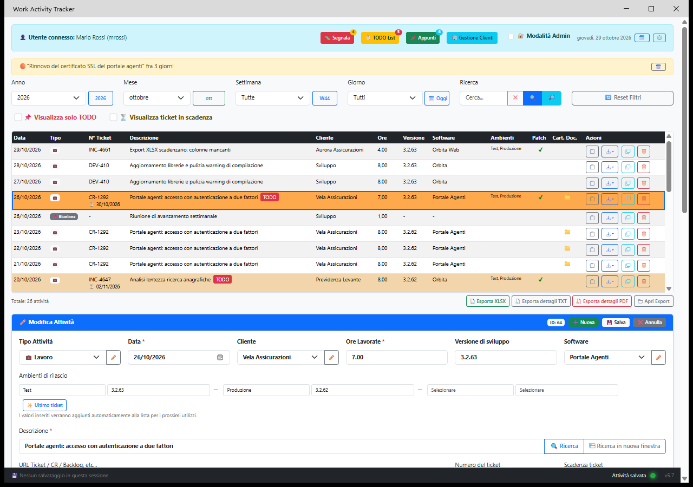

---

### Descrizione dettagliata con uno screenshot incollato
Editor con grassetto, evidenziazioni, testo colorato e immagini incollate; toolbar sopra e sotto, pulsanti 📷 ◀ 📋 ▶ in basso a destra e, sotto, i congelati su cui è riportata la modifica.

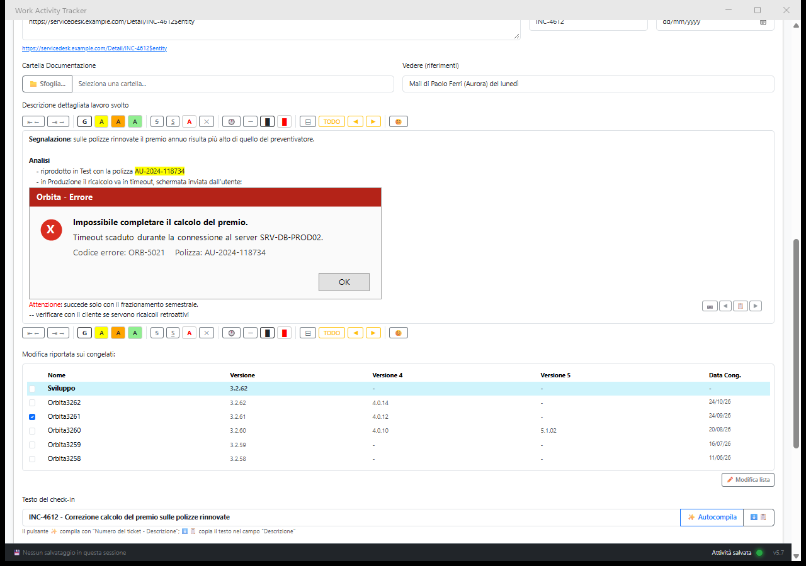

---

### Testo letto negli screenshot
Il pulsante 📷 mostra il testo che l'OCR di Windows ha letto nelle immagini del campo, pronto da copiare.

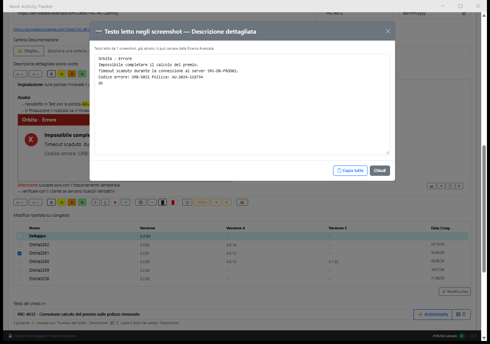

---

### Ricerca Avanzata
Ricerca su tutto lo storico, con dettaglio del risultato ed evidenziazione delle occorrenze. Qui "ORB-5021" compare solo dentro lo screenshot dell'errore: la trova la spunta "📷 Testo negli screenshot".

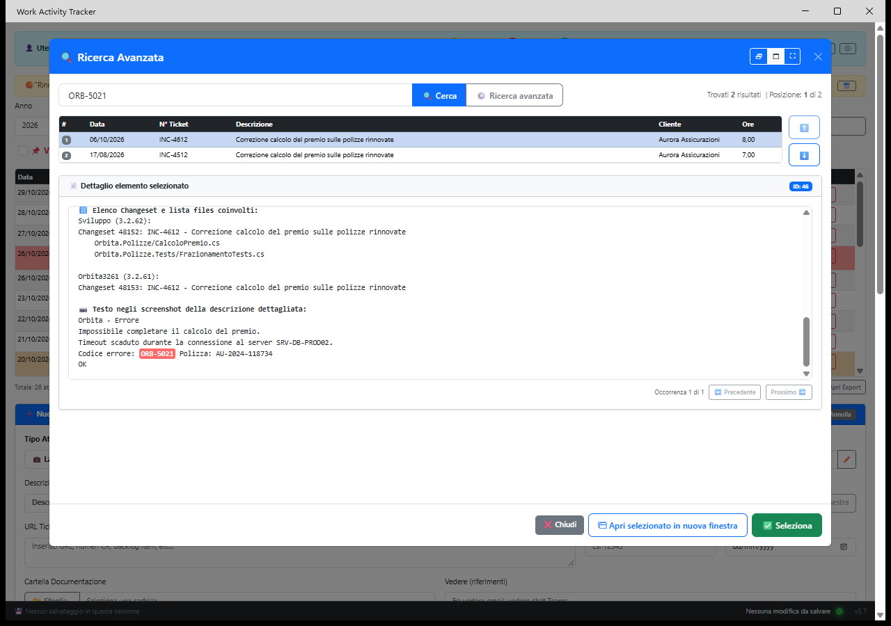

---

### Gestione Clienti
Ambienti dei clienti condivisi fra gli utenti (server, persone di riferimento, come collegarsi). La casella cerca anche nel testo degli screenshot: il badge 📷 indica che "gw-milano" è stato trovato nell'immagine del client VPN.

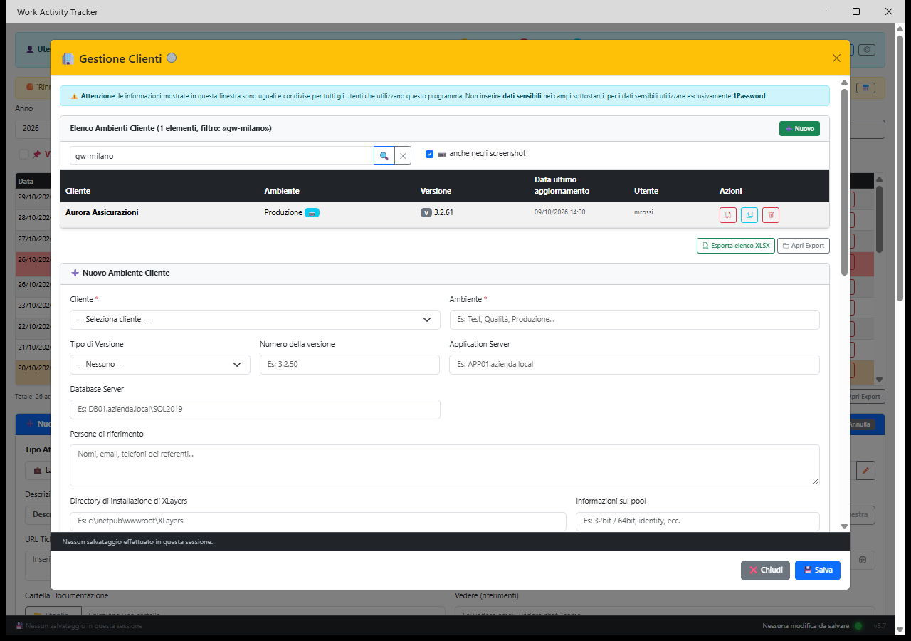

---

### TODO List
TODO personali con livello di urgenza, ricerca e nota di completamento obbligatoria per chiuderli.

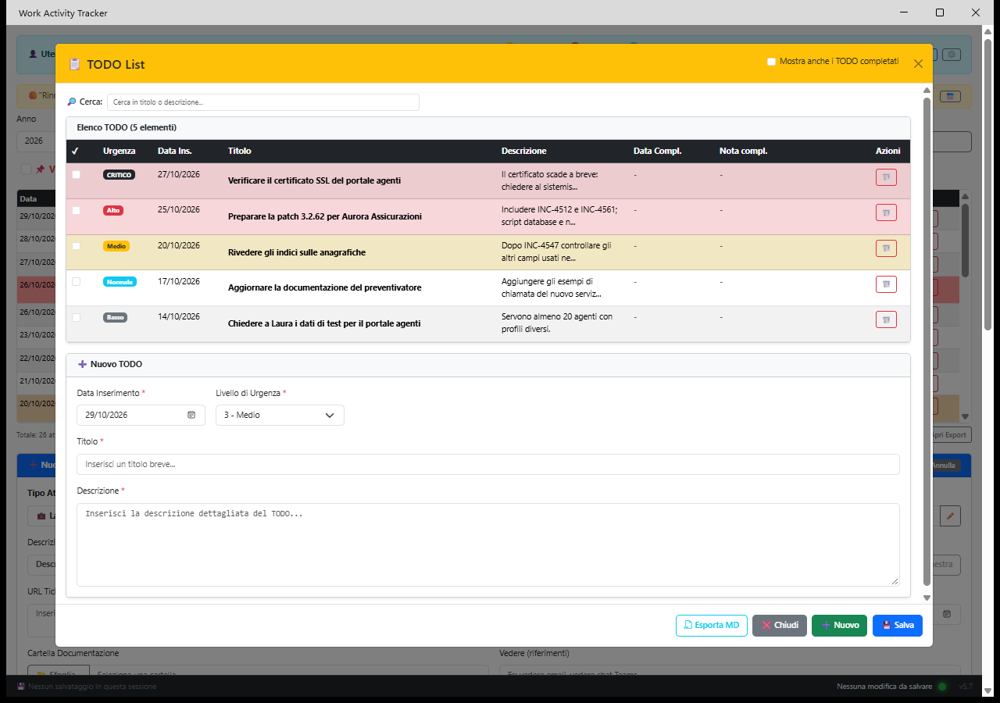

---

### Appunti / Knowledge Base
Base di conoscenza personale con tag, ricerca e dettaglio dell'appunto selezionato.

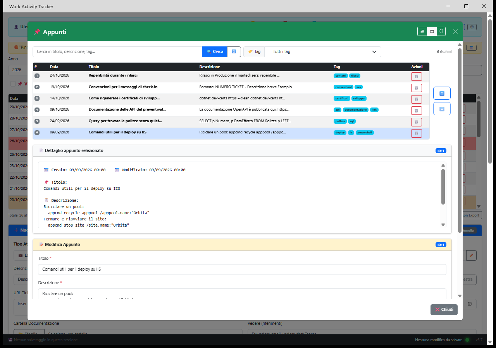

---

### Segnalazioni Bug / Richieste di Modifica
Segnalazioni fra gli utenti con filtri per stato e utente, dettaglio e risposte.

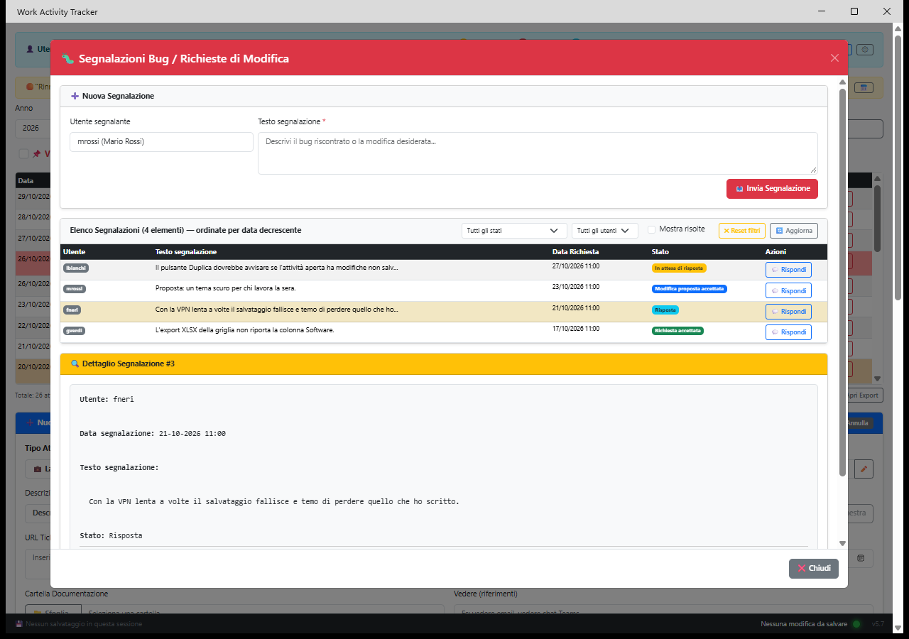

---

### Impostazioni
La finestra ⚙️: tema, colore principale e le impostazioni di `appsettings.json`.

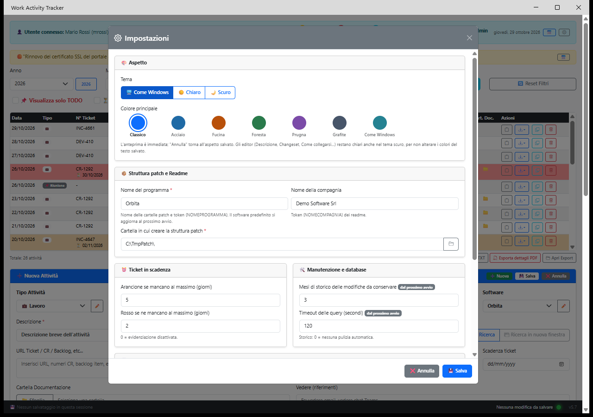

---

### Tema scuro
Tema scuro con il colore principale Acciaio. Gli editor restano chiari, come un foglio, perché il testo salvato porta i propri colori.

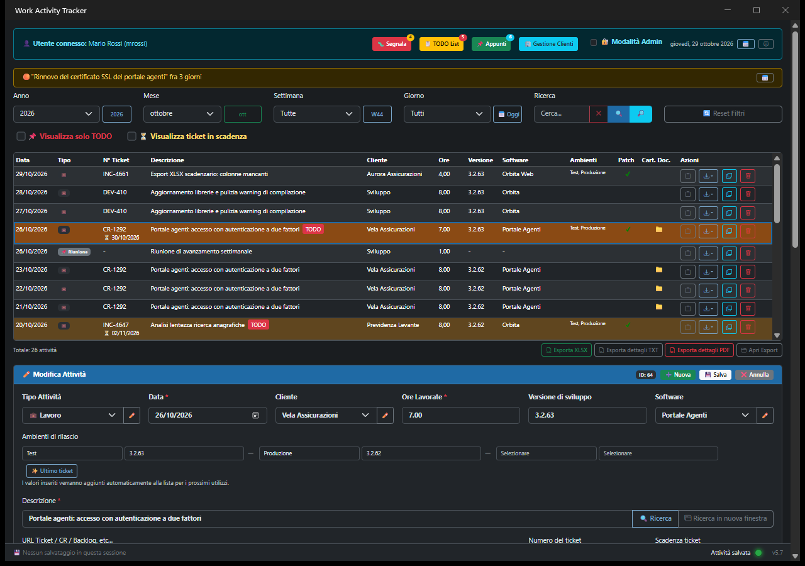

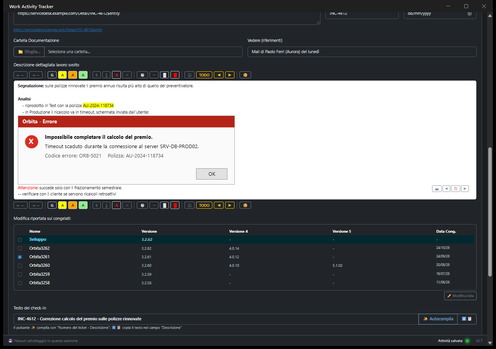

---

## Panoramica

---

## Setup e Requisiti

### Requisiti di sistema

- **Visual Studio 2022** (17.8+) con workload:
  - Sviluppo .NET Multi-platform App UI (.NET MAUI)
  - Sviluppo ASP.NET e Web
- **.NET 10 SDK** con workload MAUI: `dotnet workload install maui`
- **SQL Server** (Express, Developer o Standard)
- **Riconoscimento del testo di Windows per l'italiano** (v5.7, facoltativo): serve per leggere il testo degli screenshot. Se manca, il programma lo segnala con le istruzioni (Impostazioni di Windows → Ora e lingua → Lingua e area geografica → Italiano → Opzioni lingua → Riconoscimento del testo).

### Setup Database

1. Esegui `Database/CreateDatabase.sql` in SSMS per creare il database iniziale
2. Applica in ordine tutti gli script `MigrateToVX.Y.sql` fino all'ultimo disponibile (`MigrateToV5.6.sql` richiede di impostare a mano la variabile `@NomeProgramma`, vedi lo script)
3. Configura in `appsettings.json` (root del progetto, copiato accanto all'eseguibile) la connection string. Dalla v5.7 gran parte delle altre impostazioni si modifica anche dalla finestra **⚙️ Impostazioni** (vedi §36):

```json
{
  "ConnectionStrings": {
    "DefaultConnection": "Data Source=NOME_SERVER;Initial Catalog=WorkActivityTracker;Integrated Security=True;TrustServerCertificate=True"
  },
  "AppSettings": {
    "AppName": "Work Activity Tracker",
    "Version": "5.7",
    "NumeroMesiMantenimentoHistory": 3,
    "MostraModalitaAdmin": true,
    "PrivacyMode": false,
    "NomeProgramma": "MyProgram",
    "NomeCompagnia": "MyCompany",
    "TmpPatchDir": "C:\\TmpPatch\\",
    "GiorniPreavvisoScadenzaArancione": 5,
    "GiorniPreavvisoScadenzaRosso": 2,
    "EsportaAttivitaCollegateInPdf": true,
    "TimeoutQuerySecondi": 120,
    "Tema": "ComeWindows",
    "ColorePrincipale": "Classico"
  }
}
```

> `NumeroMesiMantenimentoHistory` (default 3): all'avvio le voci dello storico modifiche (`EditorHistory`) più vecchie di questo numero di mesi vengono eliminate automaticamente in background. Un valore `0` o negativo disattiva la pulizia.
>
> `NomeProgramma` / `NomeCompagnia` / `TmpPatchDir` (v5.2): usati dalle funzioni "Autoprepara struttura patch" e "Inserisci files Readme". `NomeProgramma`/`NomeCompagnia` sono i segnaposto (`{NOMEPROGRAMMA}`/`{NOMECOMPAGNIA}`) sostituiti nei nomi cartella e nei testi readme; `TmpPatchDir` (default `C:\TmpPatch\`) è la cartella radice dove viene creata la struttura patch.
>
> `GiorniPreavvisoScadenzaArancione` (default 5) / `GiorniPreavvisoScadenzaRosso` (default 2) (v5.3): giorni di preavviso entro i quali una riga della griglia con "Scadenza ticket" valorizzata viene evidenziata in arancione chiaro o in rosso. Le scadenze già passate usano un rosso più marcato. Un valore `0` o negativo disattiva il livello corrispondente.
>
> `EsportaAttivitaCollegateInPdf` (default `true`) (v5.3): se `true`, l'export PDF di una singola attività include anche le attività collegate dalla catena "Proseguo l'attività"; se `false` esporta la sola attività selezionata.
>
> `TimeoutQuerySecondi` (default 30) (v5.5): timeout in secondi dei comandi SQL. Il valore predefinito di SqlClient è 30 secondi e sugli archivi grandi la ricerca può superarlo. Viene letto all'avvio: per renderlo effettivo occorre riavviare l'applicazione.
>
> `NomeProgramma` (v5.6): è anche il **software di default** delle attività, creato o riattivato all'avvio nella lista Software (vedi §31).
>
> `Tema` (default `ComeWindows`) / `ColorePrincipale` (default `Classico`) (v5.7): aspetto dell'interfaccia. `Tema`: `ComeWindows`, `Chiaro`, `Scuro`. `ColorePrincipale`: `Classico` (il blu di sempre), `Acciaio`, `Fucina`, `Foresta`, `Prugna`, `Grafite`, `ComeWindows`. Un valore sconosciuto vale come il predefinito. Vedi §37.
>
> La finestra **⚙️ Impostazioni** (v5.7) riscrive questo file toccando solo le chiavi che gestisce; `MostraModalitaAdmin`, `PrivacyMode` e la connection string vi compaiono in sola lettura e si modificano solo qui. Aggiornando il programma da uno zip, conserva il tuo `appsettings.json`.

### Dati dimostrativi (facoltativo)

Per provare il programma senza dati propri, `Database/DatiDemo.sql` riempie un database **appena creato** con dati inventati: quattro utenti, clienti e congelati, circa due mesi e mezzo di attività (catene "Proseguo l'attività", TODO aperti, ticket in scadenza, changeset, ambienti di rilascio, screenshot leggibili dall'OCR), TODO List, appunti, segnalazioni, calendario e Gestione Clienti. Le date sono calcolate rispetto al giorno di esecuzione.

1. Crea un database separato (es. `WorkActivityTracker_Demo`) con `CreateDatabase.sql` e tutte le migration, cambiando in testa agli script il nome del database (`USE` / `CREATE DATABASE`).
2. Esegui `DatiDemo.sql` su quel database (SSMS, oppure `sqlcmd -f 65001`): l'utente principale "Mario Rossi" è il tuo utente Windows. Lo script si ferma se nel database ci sono già attività.
3. Punta l'applicazione al database demo (`ConnectionStrings`) e imposta `"NomeProgramma": "Orbita"`. Al primo avvio il programma converte il testo e legge gli screenshot in background.

### Eseguire l'applicazione

Da Visual Studio: apri `WorkActivityTracker.csproj`, seleziona **Windows Machine**, premi F5.

---

## Funzionalità Principali

### 1. Gestione Attività Lavorative

Ogni attività registrata contiene:

| Campo | Tipo | Descrizione |
|---|---|---|
| `TipoAttivita` | string | Lavoro / Permesso / Ferie |
| `Data` | DateTime | Data dell'attività |
| `Descrizione` | string | Titolo breve obbligatorio (in **grassetto**) |
| `OreLavorate` | decimal | Ore dedicate (step 0.5) |
| `Cliente` | FK | Cliente associato |
| `Versione` | string | Versione software sviluppata (es: 3.2.61) |
| `UrlTicket` | string | URL ticket, CR, backlog (multiriga) |
| `Vedere` | string | Riferimenti esterni (email, Teams, ecc.) |
| `CartellaDocumentazione` | string | Path cartella locale con doc |
| `Note` | HTML | Descrizione dettagliata del lavoro (con grassetto) |
| `TestoCheckIn` | string | Testo del messaggio di check-in SCM (in **grassetto**) |
| `ChangesetCoinvolti` | HTML | Elenco changeset/commit coinvolti (con grassetto) |
| `NumeroTicket` | string | Numero/i del ticket (separati da virgola se più di uno) |
| `UrlPatchRilasci` | string | URL patch/pacchetto nei rilasci (NVARCHAR(MAX), può contenere più URL) |
| `AmbientiSelezionatiIds` | List\<int\> | Congelati su cui è riportata la modifica |
| `AmbientiRilascioNomi` | string? | Nomi ambienti rilascio separati da virgola (solo lettura, per griglia) |
| `SoftwareId` | FK | Software a cui si riferisce il lavoro (v5.6, solo per Lavoro) |
| `NoteOcr` / `ChangesetOcr` | string | Testo letto negli screenshot di Note e Changeset (v5.7, calcolato in background) |

Per i tipi **Permesso** e **Ferie**, vengono mostrati solo i campi Data, Ore, Descrizione e Note; gli altri campi vengono nascosti nell'interfaccia.

### 2. Griglia Attività

- Tabella con scroll verticale (max-height 300px) con sticky header.
- Filtri: Anno / Mese / Giorno + ricerca testuale full-text + checkbox "Solo TODO".
  - All'avvio: Anno e Mese impostati al mese corrente, Giorno = "Tutti".
  - Bottone **"📅 Oggi"** accanto al filtro Giorno: imposta automaticamente Anno/Mese/Giorno alla data odierna.
  - **Combo Giorno con nomi ed emoji**: quando Anno e Mese sono selezionati, ogni opzione mostra il numero + il giorno della settimana abbreviato in italiano (es. "1 - lun"). Vengono nascosti i giorni non validi per il mese selezionato. Emoji prefisso: 🟢 per il giorno odierno (ha la precedenza), 🟠 per sabato e domenica.
- **Rilevamento TODO preciso**: regex `(?<![a-zA-Z])TODO(?![a-zA-Z])` (word boundary, case-insensitive).
- **Evidenziazione TODO**: riga rossa se TODO è in Descrizione, Note, ChangesetCoinvolti, UrlTicket. (Con Bootstrap 5.3 il colore non si vedeva più perché lo sfondo delle celle copriva quello della riga: corretto in v5.7.)
- **Riga selezionata**: colore giallo vivace (`#ffe066`). Se riga TODO+selezionata: arancione. Nel tema scuro le stesse precedenze con tinte scure (§37).
- **Colonna Software** (v5.6): dopo "Versione", il software dell'attività (§31).
- **Riga totale ore**: footer con la somma delle ore delle attività visibili, allineata sotto la colonna **Ore**.
- **Colonna Ambienti**: mostra i nomi degli ambienti di rilascio compilati, separati da virgola (es. "Test, Produzione"), senza numero di versione. Calcolato da una query batch in `ActivityService.GetActivitiesAsync()` e salvato in `WorkActivityDto.AmbientiRilascioNomi`. Vuota se nessun ambiente è stato associato.
- **Colonna Patch**: mostra ✔ verde se il campo "URL Patch/Pacchetto nei rilasci" (`UrlPatchRilasci`) è compilato.
- **Colonna Azioni**: pulsanti Copia, menu Esporta (TXT/PDF), Duplica, Elimina — con le icone Bootstrap Icons dalla v5.6 (§33).
  - **Copia** (`bi-clipboard`): genera testo plain dell'attività (HTML stripped) e lo copia negli appunti.
  - **Esporta** (`bi-download`, menu a tendina): TXT o PDF della singola attività nella cartella `Export/`.
  - **Duplica** (`bi-copy`): copia tutti i campi tranne la data (incluso NumeroTicket e ChangesetCoinvolti). La **Descrizione dettagliata lavoro svolto (Note) NON viene copiata**: al suo posto viene inserito un header puntatore `**** Proseguo l'attività [Id]-[Descrizione]-[NumeroTicket] del [Data] ****` riferito all'attività di origine (evita di gonfiare il record su lavorazioni multi-giorno). Il lavoro dei giorni precedenti resta consultabile col pulsante "Mostra la descrizione del lavoro svolto nei giorni precedenti" (vedi §5).
  - **Elimina** (`bi-trash`): mostra una **modale Blazor custom centrata** per la conferma.
- **Pulsanti export sotto la griglia** (visibili se ci sono attività):
  - **Esporta XLSX**: esporta la griglia visualizzata in Excel (`ElencoAttivitàAl[timestamp].xlsx`).
  - **Esporta dettagli TXT**: esporta tutte le attività visibili in un TXT (`DettaglioTutteLeAttività_[dal]_[al]_[timestamp].txt`).
  - **Esporta dettagli PDF**: vedi §21.
  - **Apri Export**: apre la cartella `Export/` in Esplora Risorse.
- Dopo il salvataggio, l'attività appena salvata rimane selezionata nella griglia.

### 3. Form di Inserimento/Modifica

La testata (header blu) contiene bottoni rapidi Nuova / **Salva (Ctrl+S)** / Annulla replicati in piccolo. I bottoni principali sono anche nel footer del form.

**Shortcut Ctrl+S**: salva l'attività corrente in qualsiasi momento (registrato via `registraCtrlS` JS + `[JSInvokable] SalvaViaShortcut()`). Dalla v5.7 funziona anche con il cursore ancora dentro un campo appena modificato: prima veniva salvato il valore precedente, perché `@bind` aggiorna il valore solo quando il campo perde il focus.

Il campo **Cliente** ha un bottone **✏️** che apre la modale `ClientiEditorModal` per gestire la lista clienti (con log delle modifiche in `Clienti_Log`).

Nella prima riga, dopo "Versione di sviluppo", la combo **Software** (v5.6, §31). Accanto a "🔍 Ricerca" della Descrizione, il pulsante **"Ricerca in nuova finestra"** (v5.6, §32).

### 4. Ambienti di Rilascio (Form, v4.1)

Visibili nel form solo quando `TipoAttivita == Lavoro` e il cliente selezionato è diverso da "Sviluppo". Comprendono 3 coppie **(Tipo ambiente / Versione)** disposte orizzontalmente:

- **Tipo ambiente**: `<input list>` con `<datalist>` alimentato da `TipiAmbientiRilascio` (es. Test, Qualità, Pre-produzione, Produzione).
- **Versione**: `<input list>` con `<datalist>` alimentato da `VersioniRilascio` (es. 3.2.50, 4.1.10).
- I valori nuovi digitati vengono aggiunti automaticamente ai rispettivi lookup al salvataggio (`EnsureTipoExistsAsync`, `EnsureVersioneExistsAsync`).
- Dati persistiti in `AttivitaAmbientiRilascio` (con `Posizione` 1-3). Caricati in `SelezionaAttivita()` tramite `AmbientiRilascioService.GetAmbientiRilascioAsync()`.
- Il DTO `WorkActivityDto.AmbientiRilascio` contiene sempre 3 coppie `AmbienteRilascioDto` (Posizione, TipoAmbiente, Versione). Il campo `AmbientiRilascioNomi` (string?) è calcolato da `ActivityService.GetActivitiesAsync()` per la colonna della griglia.

### 5. Editor "Descrizione dettagliata lavoro svolto" (Note)

Campo `contenteditable` (non textarea) con toolbar di editing:
- **⇥ →** / **⇤ ←**: indentazione destra/sinistra delle righe selezionate.
- **G** (Grassetto): applica/rimuove bold con `document.execCommand('bold')`.
- **A** giallo / **A** arancione / **A** verde: evidenziatura del testo selezionato (hiliteColor).
- **S** barrato / **S** sottolineato: formattazione barrato e sottolineato.
- **A** rosso: colora il testo in rosso.
- **✕**: rimuove tutta la formattazione (bold, colore, highlight, sottolineato, ecc.).
- **📷** / **◀** / 📋 / **▶**: Testo letto negli screenshot (v5.7, §34) / Undo / Storico versioni / Redo (overlay in basso a destra dell'editor, sopra le scrollbar).
- **⊟**: rimuove le righe vuote dal contenuto dell'editor.
- **TODO**: sostituisce ogni occorrenza di "TODO" (parola isolata) con `--`, preservando tutta la formattazione HTML.
- Altezza: min 200px, max 500px con scroll verticale.
- Font: Segoe UI, `white-space: pre-wrap`.
- **Bordo rosso** se il campo contiene TODO.
- Salva/carica **HTML** (`innerHTML`) per persistere il grassetto nel database.
- La sincronizzazione avviene via `noteEditorHelper` (JS): `setContent`, `getHtml`, `getText`, `indent`, `rimuoviRigheVuote`.

**Lavoro dei giorni precedenti (catena "Proseguo l'attività", v5.1):** quando la Note inizia con l'header `**** Proseguo l'attività [Id]... ****` (generato dalla Duplica), sopra la label compare il pulsante **"Mostra la descrizione del lavoro svolto nei giorni precedenti"**. Al click viene ricostruita on-demand la catena delle attività collegate — seguendo i puntatori `Id` nelle Note, di attività in attività — e il risultato è mostrato in un **riquadro di sola lettura** (stessa altezza dell'editor) che **renderizza l'HTML**: quindi **screenshot, grassetti ed evidenziazioni delle Note precedenti sono visibili** (è un `div` con `MarkupString`, non una `textarea` che mostrerebbe solo testo). Le sezioni sono in ordine cronologico (dalla data più vecchia alla più recente), ciascuna intestata `====== [Id]-[Descrizione]-[NumeroTicket] del [Data] ======`, con la riga "Proseguo" rimossa perché ridondante. Il pulsante diventa **"Nascondi..."**. Nessun dato viene duplicato nel DB: la cronologia è ricostruita seguendo i rimandi. Il caricamento è **on-demand con cache per-selezione**: la catena viene letta dal database solo al primo click, poi i successivi "Mostra/Nascondi" sono istantanei finché non si cambia attività.

### 6. Congelati (Ambienti di Rilascio)

La sezione "Modifica riportata sui congelati" mostra una tabella checkbox con:
- **Sviluppo** (riga virtuale): versione di sviluppo corrente.
- **Ambienti dal DB**: Codice, Versione, Data congelamento.

Quando si spunta un congelato: viene aggiunto automaticamente un blocco nell'editor Changeset (se non già presente):
```
NomeCongelato (Versione):
Changeset XXX: [Testo del check-in]
```

### 7. Editor "Elenco Changeset e lista files coinvolti"

`div` con `contenteditable="true"` con toolbar di editing:
- **⇥ →** / **⇤ ←**: indentazione (cursore rimane sulla stessa riga dopo l'operazione).
- **G** (Grassetto): applica/rimuove bold.
- **A** giallo / **A** arancione / **A** verde: evidenziatura del testo selezionato (hiliteColor).
- **S** barrato / **S** sottolineato: formattazione barrato e sottolineato.
- **A** rosso: colora il testo in rosso.
- **✕**: rimuove tutta la formattazione (bold, colore, highlight, sottolineato, ecc.).
- **📷** / **◀** / 📋 / **▶**: Testo letto negli screenshot (v5.7, §34) / Undo / Storico versioni / Redo (overlay in basso a destra dell'editor, sopra le scrollbar).
- **⊟**: rimuove le righe vuote dal contenuto dell'editor.
- **TODO**: sostituisce ogni occorrenza di "TODO" (parola isolata) con `--`, preservando tutta la formattazione HTML.
- Altezza: min 200px, max 350px, scroll verticale **e orizzontale**.
- Font monospace (Consolas), `white-space: pre`.
- Salva/carica **HTML** (`innerHTML`) per persistere il grassetto.
- Sincronizzazione via `changesetEditorHelper` (JS): `setContent`, `getHtml`, `getText`, `indent`, `rimuoviRigheVuote`.
- `AggiungiBloccoCongelato()`: usa `HtmlToPlainText()` per i confronti stringa, poi appende il nuovo blocco come HTML (`<strong>heading</strong><br>Changeset XXX: testo`) preservando la formattazione esistente.

### 8. TODO List (Modale)

Modale separata per gestire TODO personali. Ogni TODO: Titolo, Descrizione, Data inserimento, Urgenza (1-5), Completato. Badge con contatore nel pulsante in alto. Pulsante **📥 Export MD** nel footer per esportare la lista in formato Markdown (tabella GFM) nella cartella `Export/`.

**Nota di completamento (v5.4):** accanto alla spunta "Completato" c'è una textarea **"Nota di completamento"**, disabilitata finché il TODO è aperto e **obbligatoria** per salvarlo come completato. Per questo la checkbox nella griglia non chiude più il TODO al volo: selezionandola il TODO viene aperto nel form con la spunta già messa, in attesa della nota (riaprire un TODO resta invece immediato). Togliendo la spunta la nota viene azzerata. La nota compare come colonna in griglia e nell'Export MD.

### 9. Appunti / Knowledge Base (Modale)

Modale per note rapide con sistema di tag (Titolo, Descrizione, Tag multi-valore). Badge con contatore nel pulsante in alto.

### 10. Editor Clienti (Modale)

Modale `ClientiEditorModal` aperta dal pulsante ✏️ accanto al campo Cliente:
- CRUD completo: aggiungi, modifica, disattiva cliente.
- **Lingua struttura patch (v5.2)**: select Italiano/Inglese (`Clienti.Lingua`, default IT) che determina la lingua dei nomi cartella nella funzione "Autoprepara struttura patch" e i readme proposti. Colonna "Lingua" mostrata anche nella griglia.
- Ogni modifica è tracciata in `Clienti_Log`: NomeUtente, AzioneSvolta (Nuovo/Modifica/Elimina), VecchioValore, NuovoValore, Timestamp.

### 11. Editor Congelati (Modale)

Modale `CongelatiEditorModal` aperta dal pulsante "✏️ Modifica lista" sotto la tabella congelati. Log in `Ambienti_Log`.

- Campi: Codice, Versione, Data Congelamento, **Data Dismissione**, Attivo, **Note** (v5.4).
- **📋 Esporta MD**: esporta la griglia in formato Markdown (tabella GFM) nella cartella `Export/` (`Congelati_[timestamp].md`).
- **Data Dismissione**: obbligatoria quando la checkbox "Attivo" viene deselezionata; il form mostra un errore di validazione se mancante. Mostrata come colonna nella griglia.
- **Note (v5.4)**: testo libero per descrivere il Codice (a cosa serve, particolarità, riferimenti). Presente nel form, come colonna in griglia (troncata, testo completo nel tooltip) e nell'export MD.
- Il log `Ambienti_Log` include `DataDismissione` nei campi `VecchioValore` e `NuovoValore` per tracciabilità completa; le `Note` vi entrano **troncate a 100 caratteri**, per non gonfiare la tabella di log a ogni modifica.

### 12. Ricerca Avanzata (Modale)

Ricerca full-text su tutte le attività (senza filtri data) con griglia risultati, navigazione frecce, evidenziazione rossa, selezione attività nel form.

**Ricerca lato server (v5.2):** la finestra **non precarica più** l'intero storico (che con Note ricche di screenshot base64 poteva richiedere 30–60 secondi ad aprirsi). La ricerca è eseguita su **SQL Server** (`ActivityService.RicercaAvanzataAsync`, `EF.Functions.Like` sui soli campi selezionati) e restituisce risultati **leggeri** (senza Note/Changeset); il contenuto completo della voce selezionata viene caricato **on-demand** (con cache). L'apertura è così **istantanea** anche su archivi grandi.

**Spazi come jolly (v5.3):** ogni sequenza di spazi, tabulazioni o a capo nel testo cercato diventa un jolly `%` nel `LIKE`. Serve perché con la ricerca su SQL un testo salvato con **doppio spazio** (o mandato a capo) non veniva più trovato scrivendolo con spazio singolo — `LIKE` non sa esprimere "uno o più spazi". Effetto collaterale accettato: tra due parole può comparire altro testo. La collation `Latin1_General_CI_AS` rende la ricerca **accent-sensitive**: `sigre` non trova `sigrè`.

**Colonna "N° Ticket" e stato di attesa (v5.3/v5.4):** la griglia dei risultati mostra il numero del ticket dopo la data. Durante l'esecuzione della query compare **"Ricerca in corso, attendere…"** con rotellina, e il pulsante Cerca si disabilita: prima, per tutta la durata della ricerca, veniva mostrato "Nessun risultato trovato".

**"Apri selezionato in nuova finestra" (v5.6):** pulsante nel footer, accanto a "✅ Seleziona": apre il risultato in un'altra finestra del programma (§32), lasciando aperta la Ricerca Avanzata.

**📷 Testo negli screenshot (v5.7):** spunta che estende la ricerca al testo letto negli screenshot di Note e Changeset; nel dettaglio del risultato compaiono le sezioni "📷 Testo negli screenshot…" con le occorrenze evidenziate (§34).

### 13. Segnalazioni (Modale)

Pulsante **"🐛 Segnala"** nella barra superiore (sempre visibile, indipendente dalla modalità admin), apre la modale `SegnalazioniModal`:

- **Form invio**: combo utente (auto-seleziona utente corrente) + textarea + bottone "Invia Segnalazione".
- **Griglia segnalazioni**: Utente, Testo (troncato), Data, Stato con badge colorati. Pulsante "💬 Rispondi" sempre visibile (anche per chi ha originato la segnalazione).
- **Dettaglio segnalazione selezionata**: testo formattato readonly con Utente, Data, Testo, Stato, storico risposte.
- **Form risposta**: textarea + combo stato + bottone "Invia Risposta".
- **Stati disponibili**: In attesa di risposta, Risposta, Richiesta accettata, Richiesta rifiutata, Modifica proposta accettata, Risolto.

### 14. Modalità Admin

Attivabile tramite checkbox (configurabile in `appsettings.json` con `MostraModalitaAdmin`):
- Mostra le attività di tutti gli utenti (eccetto quelli con `PrivacyMode: true`).
- Impedisce la modifica di attività altrui.

### 15. Avviso Modifiche Non Salvate

Quando si tenta di chiudere la finestra con modifiche non salvate nell'attività, viene mostrato un dialogo di conferma. Implementato via `UnsavedChangesService` (singleton) + `AppWindow.Closing` (WinUI nativo) in `App.xaml.cs`. Fino alla v5.6 il servizio non veniva mai alimentato e l'avviso non scattava: dalla v5.7 segue l'indicatore qui sotto.

**Indicatore nella barra di stato (v5.7):** pallino **verde** (attività salvata / nessuna modifica), **rosso** (modifiche da salvare) o **grigio** (sola consultazione: finestra di confronto o, in admin, attività di un altro utente). Il rilevamento avviene nel browser (`modificheFormHelper` in `index.html`): eventi `input`/`change` per i campi e un `MutationObserver` per gli editor Note/Changeset, perché indentazione, rimozione righe vuote e simili riscrivono l'HTML senza generare eventi. Se si continua a scrivere mentre un salvataggio lento è in corso, il pallino resta rosso.

**Conferma prima di perdere le modifiche (v5.7):** con il pallino rosso, i comandi che sostituiscono l'attività nel form — riga della griglia, ➕ Nuova, ❌ Annulla, Duplica, "✅ Seleziona" della Ricerca Avanzata, ♻️ Ripristina bozza — mostrano la modale **"⚠️ Modifiche non salvate"** con **↩️ Resta sull'attività**, **🗑️ Scarta le modifiche** e **💾 Salva e continua** (che prosegue solo se il salvataggio riesce). Tutti passano da `EseguiConControlloModifiche`: un nuovo pulsante che cambia attività deve usarlo.

### 16. Export Attività

- File salvati nella sottocartella `Export/` nella directory dell'eseguibile (creata automaticamente).
- Naming convention: `ElencoAttivitàAl[yyyyMMdd_HHmmss].xlsx`, `DettaglioTutteLeAttività_[dal]_[al]_[timestamp].txt`, `DettaglioAttività_[data]_[descrizione]_[timestamp].txt`.
- I campi HTML (Note, ChangesetCoinvolti) vengono convertiti in testo plain via `HtmlToPlainText()` prima dell'export.
- L'ultimo file esportato viene mostrato nella barra di stato.
- XLSX generato con **ClosedXML** (pacchetto NuGet 0.105.1).

### 17. Barra di Stato

Barra fissa in fondo alla finestra:
- **💾 Ultimo salvataggio**: orario HH:mm:ss dell'ultimo salvataggio riuscito.
- **📤 Export**: nome dell'ultimo file esportato (con tooltip percorso completo).
- **🔐 Modalità Admin attiva**: badge in admin mode.
- **🔒 Privacy attiva**: badge se `PrivacyMode: true`.
- **Pallino modifiche non salvate** (v5.7): verde / rosso / grigio, vedi §15.
- **Versione app**: numero da `appsettings.json`.

### 18. Privacy Mode

Proprietà booleana `PrivacyMode` in `appsettings.json`. Se `true`: le attività dell'utente non sono visibili ad altri utenti in modalità Admin. Si modifica solo a mano nel file: la finestra ⚙️ Impostazioni (v5.7) la mostra in sola lettura.

### 19. Colonna "Cart. Doc." nella Griglia (v4.5)

La colonna **Cart. Doc.** è stata aggiunta alla griglia delle attività (tra "Patch" e "Azioni").
Mostra l'icona 📁 verde quando il campo `CartellaDocumentazione` è compilato; il tooltip riporta il percorso completo. Se il campo è vuoto la cella è vuota.

### 20. Storico Versioni Editor — Undo/Redo (v4.5)

Ogni volta che un'attività viene salvata, il contenuto HTML dei campi **Note** e **ChangesetCoinvolti** viene registrato nella tabella `EditorHistory` (storico infinito, associato all'utente e all'attività).

Tre pulsanti sono posizionati come **overlay nell'angolo in basso a destra** di ciascuna textarea editor (non nella toolbar):

| Pulsante | Azione |
|---|---|
| ← | Torna alla versione precedente salvata (Undo) |
| 📋 | Apre la modale `EditorHistoryModal` con la lista completa delle versioni |
| → | Avanza alla versione successiva salvata (Redo) |

I pulsanti sono disabilitati finché l'attività non è stata salvata almeno una volta. Il campo viene registrato nello storico **solo se non è vuoto** (verifica tramite `HtmlToPlainText`) e **solo se il contenuto è diverso dall'ultimo salvataggio** (evita duplicati consecutivi in `EditorHistory`).

**Logica navigazione:**
- Indice `-1` = contenuto corrente non ancora salvato (stato iniziale).
- Al primo Undo: il contenuto corrente viene memorizzato in memoria, viene caricata la lista storico da DB e viene mostrata la versione 0 (più recente).
- Undo successivi: incrementa l'indice (va a versioni più vecchie, fino all'ultima).
- Redo da indice 0: ripristina il contenuto memorizzato (torna all'indice -1).
- Redo da indice >0: decrementa l'indice (torna a versioni più recenti).
- Il cache storico viene azzerato ad ogni salvataggio e quando si seleziona un'altra attività.

**Modale `EditorHistoryModal.razor`:**
- Griglia con data salvataggio (`dd/MM/yyyy HH:mm:ss`) e anteprima testo (primi 100 caratteri, HTML strippato).
- Riga selezionata evidenziata in giallo (`table-warning`).
- Pulsanti ↑ ↓ per navigare le righe con contatore "N di Totale".
- Div di anteprima dettagliato con HTML renderizzato (readonly).
- Bottoni "Annulla" (chiude senza modifiche) e "✔ Seleziona" (chiude e applica la versione all'editor).

**Pulizia automatica (v5.1):** all'avvio dell'applicazione, in background, le voci di `EditorHistory` più vecchie di `NumeroMesiMantenimentoHistory` mesi (impostazione in `appsettings.json`, default 3) vengono eliminate automaticamente (`EditorHistoryService.EliminaVecchieAsync`), evitando la crescita illimitata della tabella. Se qualche voce viene eliminata, in testa al form appare un avviso informativo (che scompare dopo qualche secondo): *"L'History delle modifiche più vecchie di X mesi è stata eliminata. (Vedere il file appsetting per modificare questo automatismo)"*. Un valore `0` o negativo disattiva la pulizia.

### 21. Export PDF delle Attività (v5.2)

Oltre a TXT/XLSX, le attività possono essere esportate in **PDF** mantenendo le **immagini** incollate nei campi HTML (Descrizione dettagliata, Elenco Changeset):
- **🧾 per riga**: esporta la singola attività.
- **🧾 Esporta dettagli PDF** (sotto la griglia): esporta tutte le attività filtrate, una per pagina.

Implementato in `PdfExportService`: costruisce un documento HTML (Note/Changeset inseriti come HTML grezzo, immagini incluse) e lo stampa in PDF via WebView2 (`CoreWebView2CompositionController.PrintToPdfAsync`), riusando l'environment WebView2 di BlazorWebView catturato in `MainPage`. I file finiscono in `Export/`.

### 22. Autoprepara Struttura Patch (v5.2)

Accanto al campo "📦 URL Patch/Pacchetto nei rilasci" due pulsanti:
- **🛠 Autoprepara struttura patch**: crea in `TmpPatchDir` (default `C:\TmpPatch\`) la cartella del rilascio `{Cliente}\{AAAA-MM-GG}_{NOMEPROGRAMMA}_{VERSIONE}_{AMBIENTI}_{TICKET}\` (versione `X.Y.Z` → `X.Y_SPZ`; nomi senza spazi/accenti; ticket con virgole → `_`) e l'intera struttura di sottocartelle (Prerequisiti, Database Server, Application Server → Componenti Server / Setup Web, Client). È **idempotente**: se la cartella esiste già non viene toccata.
- **📁**: apre in Esplora Risorse **tutte** le cartelle patch create, una finestra per versione.

I nomi delle sottocartelle sono in **italiano o inglese** in base alla **lingua del cliente** (`Clienti.Lingua`): es. `00_PREREQUISITI`/`00_PREREQUISITES`, `01_COMPONENTI_SERVER`/`01_SERVER_COMPONENTS`.

**Una cartella per versione (v5.3):** gli ambienti di rilascio che condividono la **stessa** versione vengono accorpati in un'unica cartella (`..._Test_Produzione_...`); se le versioni sono **diverse** viene creata una cartella separata per ciascuna, es. `2026-09-04_PROGRAMMA_3.2_SP50_Debug_1010C` e `2026-09-04_PROGRAMMA_3.2_SP60_Produzione_1010C`. Il raggruppamento avviene sulla versione già normalizzata, così due scritture equivalenti non generano cartelle doppie.

### 23. Inserisci files Readme (v5.2)

Pulsante **TXT** (tooltip "Inserisci files Readme") accanto ai pulsanti patch. Apre una popup (`ReadmeTemplatesModal`) con i modelli di istruzioni d'installazione filtrati per la lingua del cliente. I modelli sono definiti in **`ReadmeTmplates.json`** (root del progetto): array di voci `{Titolo, Lingua, Descrizione, DirectoryDiSalvataggio}`. Selezionando le voci e premendo **Inserisci**, viene creato un unico **`Readme.txt`** per ciascuna cartella di destinazione (sezioni separate da una linea `===` con il titolo di ciascun readme); i file già presenti non vengono sovrascritti. I segnaposto `{NOMEPROGRAMMA}`, `{NOMECOMPAGNIA}`, `{CLIENTE}`, `{VERSIONE}` vengono sostituiti (anche nel titolo). Richiede di aver prima premuto "Autoprepara struttura patch".

**Readme in tutte le strutture (v5.3):** quando gli ambienti hanno versioni diverse e sono state create più cartelle patch, i readme selezionati vengono scritti in **ognuna** di esse. Il segnaposto `{VERSIONE}` è risolto **per cartella**, quindi ogni `Readme.txt` riporta la versione della propria struttura.

### 24. Auto-compilazione Numero Ticket + Autocompila Check-in (v5.2)

- **Numero ticket dai link**: uscendo dal campo "URL Ticket", i numeri dei ticket presenti nei link (ServiceDesk HDAPortal e TFS) vengono estratti e aggiunti in coda al campo "Numero del ticket" (solo i mancanti, senza duplicati).
- **✨ Autocompila (Testo del check-in)**: pulsante accanto a ⬇️📋 che compila il check-in come `Numero ticket - Descrizione`.

### 25. Scadenza dei Ticket (v5.3)

Campo facoltativo **"Scadenza ticket"** accanto a "Numero del ticket". Quando è valorizzato, la riga in griglia viene evidenziata in base ai giorni mancanti:

| Situazione | Colore riga |
|---|---|
| Scadenza già passata | Rosso marcato, testo in grassetto |
| Entro `GiorniPreavvisoScadenzaRosso` giorni (default 2) | Rosso |
| Entro `GiorniPreavvisoScadenzaArancione` giorni (default 5) | Arancione chiaro |

L'evidenziazione ha la **precedenza sul colore delle righe TODO** (altrimenti sarebbe invisibile proprio nel caso d'uso principale); la riga selezionata resta comunque distinguibile. Nella colonna "N° Ticket" compare anche la data di scadenza con l'icona ⏳.

**Filtro "⏳ Visualizza ticket in scadenza"**: spunta accanto a "Visualizza solo TODO". Attivandola viene spuntata automaticamente anche "solo TODO" e la griglia mostra le sole attività **con TODO e con scadenza valorizzata**, ordinate dalla **scadenza più vicina** in cima. Togliendo "solo TODO" si disattiva anche questo filtro.

### 26. Autocompila Ambienti di Rilascio (v5.3)

Pulsante **"✨ Ultimo ticket"** a destra delle tre coppie ambiente/versione. Compila ambienti **e** versioni copiandoli dall'**ultimo ticket lavorato per lo stesso cliente** che abbia almeno una coppia valorizzata. La ricerca spazia su **tutti gli utenti** (come in modalità admin) indipendentemente dalla spunta admin, escludendo però le attività degli utenti in `PrivacyMode`. L'attività aperta è esclusa, così il pulsante non ricopia sé stessa. Un messaggio riporta quante coppie sono state compilate e da quale ticket.

### 27. Bozza di Emergenza su File (v5.3)

Pensata per chi accede al database tramite **VPN**: se la connessione cade mentre si compila un'attività, il salvataggio fallisce e il lavoro — comprese le Note con gli screenshot — andrebbe perso.

- Quando il salvataggio a database fallisce, l'intero contenuto del form viene serializzato in **`Bozze\bozza_attivita.json`** e il messaggio d'errore riporta il percorso.
- Ripremendo 💾 Salva a connessione ripristinata, l'attività viene scritta nel database e il file **eliminato automaticamente**.
- Se l'applicazione viene chiusa nel frattempo, al riavvio compare in testa al form un banner *"È presente una bozza non salvata del …"* con i pulsanti **♻️ Ripristina** e **🗑️ Elimina**. Il rilevamento avviene **prima** della connessione al database, quindi il banner compare anche a DB ancora irraggiungibile.
- Ripristinare non cancella il file: solo un salvataggio riuscito lo fa, così un secondo tentativo fallito non lascia scoperti.

### 28. Icone e Navigazione TODO negli Editor (v5.3)

Nelle toolbar di **"Descrizione dettagliata lavoro svolto"** e **"Elenco Changeset"** (sia sopra sia sotto ogni editor):

- **😊 Pannello icone**: apre un pannello con le icone raggruppate per categoria (Stati ed esiti, Frecce e flusso, Sviluppo e sistemi, Tempo, Persone, Analisi, Faccine). Il click **inserisce l'icona direttamente nel punto del cursore** — niente passaggio dagli appunti — e il pannello resta aperto per inserirne altre. Una riga "Usate di recente" (max 12) è condivisa fra tutti i pannelli.
- **◀ ▶ Navigazione TODO**: salta da un TODO all'altro dentro il testo senza scorrerlo a mano, selezionando l'occorrenza e scrollando l'editor. Un badge mostra `n/tot` (o "nessun TODO"). Il contenuto **non viene modificato**: la ricerca avviene sui nodi di testo, senza inserire marcatori nell'HTML che finirebbe nel database. Il conteggio è ricalcolato a ogni salto, quindi resta corretto anche mentre si scrive.

### 29. Export PDF: ambienti e attività collegate (v5.3)

- Il PDF di un'attività include ora la voce **"🚀 Ambienti di rilascio"** con le coppie `Ambiente — Versione`.
- L'etichetta "Versione" è stata rinominata in **"Versione attualmente in Sviluppo"** (anche negli export TXT).
- Se `EsportaAttivitaCollegateInPdf` è `true`, l'export di una **singola** attività include anche tutte le attività collegate dalla catena "**** Proseguo l'attività … ****", in ordine cronologico crescente e una per pagina: il documento si legge come la progressione del lavoro. Vale solo per l'export della singola attività, dato che in "Esporta dettagli PDF" le attività ci sono già tutte.

### 30. Indicatore di avanzamento negli Export (v5.3)

Tutti gli export (XLSX, dettagli TXT/PDF, singola attività TXT/PDF) mostrano **"Generazione … in corso…"** con rotellina accanto a **📁 Apri Export**, e una rotellina al posto dell'icona sul pulsante della riga da cui è partito l'export. Gli altri pulsanti export si disabilitano: un export alla volta. Il lavoro pesante (generazione XLSX, composizione dell'HTML con gli screenshot in base64) gira su un thread di background, così l'interfaccia resta reattiva invece di apparire bloccata.

### 31. Campo Software (v5.6)

Combo **Software** nella prima riga del form, dopo "Versione di sviluppo", visibile solo per le attività di tipo **Lavoro** (salvando un altro tipo il valore viene azzerato).

- La lista è **condivisa** fra tutti gli utenti (tabelle `Software` + `Software_Log`) e si gestisce dalla ✏️ accanto alla combo (`SoftwareEditorModal`): aggiunta, rinomina, ordine, disattivazione. Il log registra lo stato completo prima/dopo.
- **Default**: `NomeProgramma` di `appsettings.json`, creato o riattivato all'avvio (`SoftwareService.EnsureSoftwareDefaultAsync`); nella modale è marcato "Default" e non si può rinominare né disattivare.
- **Eliminazione soft**: un software disattivato sparisce dalla combo ma le attività che lo usano continuano a mostrarlo (con la voce "(disattivato)").
- Riferimento per **Id**: rinominando un software cambia nome anche sulle attività già salvate.
- Colonna **"Software"** in griglia, nell'export XLSX, nel PDF e nei due TXT.
- **Struttura patch e Readme** usano il software dell'attività al posto del solo `NomeProgramma`.

### 32. Finestre di Confronto (v5.6)

Per confrontare ciò che si cerca con l'attività su cui si sta lavorando, senza perderla:

- **"Ricerca in nuova finestra"** (accanto a "🔍 Ricerca" della Descrizione): avvia un'altra istanza del programma già filtrata sulla stessa ricerca.
- **"Apri selezionato in nuova finestra"** (Ricerca Avanzata): apre il risultato selezionato in un'altra istanza, sul mese dell'attività e con l'attività già nel form; in modalità Admin (se `MostraModalitaAdmin` lo consente) anche le attività dei colleghi.

Le finestre di confronto sono riconoscibili dal titolo ("— Confronto (sola consultazione)") e da un banner, e sono in **sola consultazione per l'attività**: Salva, Ctrl+S ed Elimina sono disattivati, perché due finestre sulla stessa attività si sovrascriverebbero. Le modali (TODO, Appunti, Gestione Clienti, ecc.) restano operative. Non eseguono i lavori di avvio (bozza, pulizia storico, conversioni e lettura degli screenshot in background), che restano della finestra principale. Implementazione in `Services/IstanzaConfronto.cs` (`Process.Start` con argomenti `--confronto --cerca …` / `--apri <id> [--admin]`), possibile perché l'app non è MSIX.

### 33. Icone delle Azioni (v5.6)

Le emoji ambigue su azioni ed export (📄 copiava e 📋 duplicava, 💾 era l'export TXT, 🧾 il PDF) sono state sostituite da **Bootstrap Icons** 1.11.3 (CDN in `index.html`), con una convenzione unica in tutta l'app: `bi-clipboard` copia negli appunti, `bi-copy` duplica/clona, `bi-trash` elimina, `bi-filetype-txt` / `bi-filetype-pdf` / `bi-filetype-xlsx` / `bi-filetype-md` per gli export, `bi-folder2-open` "Apri Export". Nella griglia attività TXT e PDF della singola riga sono raccolti nel menu a tendina **Esporta** (posizionamento `fixed`, altrimenti il contenitore con scroll taglierebbe la tendina). Le emoji restano nei titoli, nei pulsanti Salva e nei testi degli export.

### 34. Testo negli Screenshot — OCR (v5.7)

Il testo degli screenshot incollati nella Descrizione dettagliata e nei Changeset (``) viene letto con il **riconoscimento del testo di Windows** (`Windows.Media.Ocr`: gratuito, senza internet) e salvato in `Attivita.NoteOcr` / `ChangesetOcr`.

- **In background**, all'avvio e dopo ogni salvataggio: il salvataggio non aspetta l'OCR. Al primo avvio vengono letti tutti gli screenshot già presenti, dalla attività più recente, con un banner di avanzamento. Ogni postazione legge solo le attività del proprio utente; la finestra di confronto non legge.
- **Impronta al posto di un flag**: `Attivita.OcrImpronta` è lo SHA-256 degli screenshot di entrambi i campi (`ScreenshotHtmlHelper.CalcolaImpronta`). Salvando senza toccare le immagini l'impronta non cambia e nulla viene riletto; NULL = da leggere, stringa vuota = nessuno screenshot. La scrittura avviene solo se l'attività non è stata risalvata durante la lettura.
- **Ingrandimento 3×** prima della lettura: misurato sugli screenshot reali, a 1× il testo piccolo delle interfacce usciva storpiato.
- **Dove si usa**: la spunta "📷 Testo negli screenshot" della Ricerca Avanzata (§12). La ricerca rapida della griglia e il rilevamento dei TODO **non** lo usano.
- **Pulsante 📷** in basso a destra dei due editor: mostra il testo letto negli screenshot di quel campo (`OcrScreenshotModal`, con "Copia tutto"); se gli screenshot sono appena stati incollati li legge al momento, senza scrivere nel database.
- Se Windows non ha il riconoscimento del testo per l'italiano (o per una lingua dell'utente), un avviso spiega come attivarlo e le attività restano da leggere.
- Per far rileggere tutto: `UPDATE Attivita SET OcrImpronta = NULL WHERE OcrImpronta <> ''`.

### 35. Ricerca e Screenshot in Gestione Clienti (v5.7)

- **Casella di ricerca** sopra l'elenco degli ambienti (Invio o 🔍, ✕ per togliere il filtro). Il filtro gira su SQL e cerca in cliente, ambiente, server, persone, directory, pool, versione, nel **testo scritto** in "Come collegarsi" e "Dati ambiente" e, con la spunta **"📷 anche negli screenshot"**, nel testo dei loro screenshot. Le righe trovate grazie a uno screenshot hanno un badge 📷. Il filtro resta attivo anche dopo Salva/Elimina e alla riapertura della finestra; l'export XLSX esporta l'elenco mostrato.
- Per cercare nel testo scritto senza trovare parole dentro il base64 delle immagini servono le colonne `ComeCollegarsiTesto` / `DatiAmbienteTesto` (HTML ripulito, come `NoteTesto` v5.5); il testo degli screenshot è in `ComeCollegarsiOcr` / `DatiAmbienteOcr` con `OcrImpronta`.
- I dati sono condivisi: la lettura in background la fa **qualsiasi postazione**, con scrittura condizionata (due PC sullo stesso ambiente non si sovrascrivono).
- **Pulsante 📷** anche sui due editor della finestra.
- Una postazione ancora con una versione precedente che modifica un ambiente non aggiorna questi testi: dopo che tutti hanno aggiornato, `UPDATE ClientiAmbienti SET OcrImpronta = NULL` li fa ricalcolare.

### 36. Finestra Impostazioni ⚙️ (v5.7)

Pulsante a ingranaggio all'estremo destro della barra superiore. Modifica le impostazioni di `appsettings.json` senza aprire il file:

| Sezione | Impostazioni |
|---|---|
| 🎨 Aspetto | Tema e colore principale (§37), con anteprima immediata |
| 📦 Struttura patch e Readme | `NomeProgramma`, `NomeCompagnia`, `TmpPatchDir` (con selezione della cartella) |
| ⏰ Ticket in scadenza | Giorni di preavviso arancione / rosso |
| 🛠️ Manutenzione e database | Mesi di storico, timeout delle query (dal prossimo avvio) |
| 🧾 Export | Attività collegate nel PDF |
| ℹ️ Informazioni | **Sola lettura**: versione, Privacy, Modalità Admin, server/database/autenticazione (mai la password), percorso del file |

`ImpostazioniService` riscrive il file toccando **solo** queste chiavi (connection string e il resto restano com'erano), passando da un file temporaneo per non lasciarlo a metà, e ricarica la configurazione: i valori valgono subito, tranne quelli indicati "dal prossimo avvio". I commenti scritti a mano nel file si perdono al primo salvataggio dalla finestra.

### 37. Temi (v5.7)

- **Tema**: Come Windows / Chiaro / Scuro. Il tema scuro è quello di **Bootstrap 5.3** (`data-bs-theme`); anche la barra del titolo segue la scelta.
- **Colore principale** (pulsanti principali, intestazioni, spunte, selezione, link): Classico, Acciaio, Fucina, Foresta, Prugna, Grafite o Come Windows (accento di Windows). Il default **Classico** è il blu di sempre.
- La scelta si riapplica da sola quando `appsettings.json` cambia (anche nelle finestre di confronto aperte) e viene ripristinata prima che la pagina compaia, senza lampi chiari all'avvio.
- Nel tema scuro gli **editor e le anteprime del testo salvato restano chiari**, come un foglio: l'HTML salvato porta i propri colori (evidenziato giallo, testo rosso, testo nero incollato da altri programmi) e su sfondo scuro diventerebbe illeggibile.
- Implementazione: palette in `Services/TemaInterfaccia.cs`, `temaHelper` nell'`<head>` di `index.html` (calcola le sfumature `--wat-primario*`), colori dell'app come variabili `--wat-*` in `app.css` con la versione chiara e quella scura. Gli export PDF/TXT non cambiano.

---

## Modello Dati

### Tabelle

```
Utenti              — Utenti identificati da WindowsUsername
Clienti             — Clienti (Es: Sviluppo, Cattolica, Aviva)
Clienti_Log         — Log modifiche alla lista clienti
Ambienti            — Congelati (Codice, Versione/Descrizione, DataCongelamento, DataDismissione, Note)
Ambienti_Log        — Log modifiche agli ambienti/congelati
Attivita            — Attività lavorative principali
AttivitaAmbienti    — Relazione N:N tra Attivita e Ambienti
TodoItems           — Elementi TODO List per utente
Appunti             — Appunti/Knowledge Base per utente
AppuntiTags         — Tag associati agli appunti
Segnalazioni        — Segnalazioni bug / richieste di modifica
Segnalazioni_Risposte — Risposte alle segnalazioni
TipiAmbientiRilascio  — Lookup tipi di ambiente (Test, Qualità, Produzione, ecc.) (v4.1)
VersioniRilascio      — Lookup versioni di rilascio (v4.1)
AttivitaAmbientiRilascio — Relazione N:N tra Attivita e ambienti di rilascio (v4.1)
TipiAttivita          — Tipi attività configurabili (Lavoro/Permesso/Ferie + custom) (v4.2)
TipiAttivita_Log      — Log modifiche ai tipi attività (v4.2)
EventiCalendario      — Eventi del calendario con scadenza e stato risolto (v4.2)
EditorHistory         — Storico versioni HTML dei campi Note e ChangesetCoinvolti (v4.5)
ClientiAmbienti       — Ambienti per cliente: server, persone, come collegarsi, dati ambiente (v4.7)
ClientiAmbienti_Log   — Log modifiche agli ambienti per cliente (v4.7)
Software              — Lista condivisa dei software (v5.6)
Software_Log          — Log modifiche alla lista software (v5.6)
```

### Tipo Attività

Valori del campo `TipoAttivita` (NVARCHAR(20)):
- `Lavoro` — attività lavorativa (default)
- `Permesso` — assenza per permesso
- `Ferie` — assenza per ferie

---

## Architettura Software

```
UI (Blazor Razor)
    ↓ @inject / EventCallback
Service Layer (ActivityService, ClienteService, SegnalazioneService, ...)
    ↓ IDbContextFactory<AppDbContext>
EF Core DbContext
    ↓ SQL Server Provider
SQL Server Database
```

- **Single Page Application**: `Components/Pages/Home.razor` (~6000 righe).
- **Modali** come componenti Blazor separati in `Components/`.
- **JS Interop**: script in `wwwroot/index.html` per gli editor contenteditable e Ctrl+S.
- **Nessuna EF Migration**: aggiornamenti schema tramite script SQL manuali in `Database/`.
- **HTML storage**: i campi `Note` e `ChangesetCoinvolti` salvano HTML nel DB per persistere il grassetto. `HtmlToPlainText()` viene chiamato per export, clipboard e confronti stringa.

### Servizi registrati in `MauiProgram.cs`

| Servizio | Lifetime | Scopo |
|---|---|---|
| `ActivityService` | Scoped | CRUD attività |
| `UserService` | Singleton | Gestione utente Windows |
| `AmbienteService` | Scoped | CRUD congelati + log |
| `ClienteService` | Scoped | CRUD clienti + log |
| `TodoService` | Scoped | CRUD TODO List |
| `AppuntiService` | Scoped | CRUD Appunti/Knowledge Base |
| `SegnalazioneService` | Scoped | CRUD segnalazioni + risposte |
| `AppConfigService` | Singleton | Lettura `appsettings.json` |
| `UnsavedChangesService` | Singleton | Stato modifiche non salvate (chiusura app) |
| `AmbientiRilascioService` | Scoped | CRUD tipi ambienti e versioni di rilascio (v4.1) |
| `TipiAttivitaService` | Scoped | CRUD tipi attività dinamici (v4.2) |
| `CalendarioService` | Scoped | CRUD eventi calendario + eventi imminenti (v4.2) |
| `EditorHistoryService` | Scoped | Salvataggio e recupero storico versioni editor Note/Changeset (v4.5) |
| `PdfExportService` | Singleton | Export PDF delle attività via WebView2 composition controller (v5.2) |
| `ReadmeTemplateService` | Singleton | Carica i template readme da `ReadmeTmplates.json` (v5.2) |
| `BozzaAttivitaService` | Singleton | Salvataggio di emergenza dell'attività su file quando il DB non risponde (v5.3) |
| `HtmlTextHelper` | statico | Conversione HTML → testo semplice, condivisa fra UI e servizi (v5.5) |
| `ClienteAmbienteService` | Scoped | CRUD ambienti per cliente (Gestione Clienti) + log, ricerca lato SQL (v4.7, v5.7) |
| `SoftwareService` | Scoped | Lista software condivisa + log (v5.6) |
| `IstanzaConfronto` | statico | Avvio e argomenti delle finestre di confronto (v5.6) |
| `OcrScreenshotService` | Singleton | Lettura del testo negli screenshot con l'OCR di Windows, lavoro in background (v5.7) |
| `ScreenshotHtmlHelper` | statico | Estrazione degli screenshot base64 dall'HTML e impronta SHA-256 (v5.7) |
| `ImpostazioniService` | Singleton | Lettura/scrittura delle impostazioni della finestra ⚙️ in `appsettings.json` (v5.7) |
| `TemaInterfaccia` | statico | Palette e applicazione di tema e colore principale (v5.7) |

### Script JS in `wwwroot/index.html`

| Funzione/Helper | Scopo |
|---|---|
| `registraCtrlS(dotNetRef)` | Registra Ctrl+S globale con callback a `[JSInvokable] SalvaViaShortcut()` |
| `eseguiBold(el)` | Applica/rimuove grassetto con `document.execCommand('bold')` |
| `changesetEditorHelper.setContent(el, val)` | Imposta contenuto (rileva HTML vs plain text) |
| `changesetEditorHelper.getHtml(el)` | Restituisce `innerHTML` per salvataggio DB |
| `changesetEditorHelper.getText(el)` | Restituisce `innerText` per operazioni stringa C# |
| `changesetEditorHelper.indent(el, right)` | Indenta le righe selezionate (⇥/⇤), cursore stabile |
| `noteEditorHelper.setContent(el, val)` | Imposta contenuto Note (rileva HTML vs plain text) |
| `noteEditorHelper.getHtml(el)` | Restituisce `innerHTML` per salvataggio DB |
| `noteEditorHelper.getText(el)` | Restituisce `innerText` |
| `noteEditorHelper.indent(el, right)` | Indenta le righe selezionate nelle Note |
| `sostituisciTodoNeiNodi(el)` | Traversa i text node dell'editor e sostituisce TODO (parola isolata) con `--`, preservando HTML |
| `copyToClipboard(text)` | Copia testo negli appunti con fallback `execCommand` per MAUI |
| `modificheFormHelper` | Rilevamento delle modifiche nel form (eventi + `MutationObserver` sugli editor) per il pallino rosso/verde (v5.7) |
| `temaHelper.applica(tema, colore)` | Applica tema chiaro/scuro e sfumature del colore principale; nell'`<head>`, ripristina l'ultima scelta prima di Blazor (v5.7) |

---

## Script di Migrazione Database

Gli script SQL si trovano in `Database/` e vanno eseguiti in ordine:

| File | Contenuto |
|---|---|
| `CreateDatabase.sql` | Schema iniziale completo |
| `MigrateToV3.sql` | Prima migrazione |
| `MigrateToV3.2.sql` | Aggiunta congelati |
| `MigrateToV3.3.sql` | Aggiunta log congelati |
| `MigrateToV3.4.sql` | Aggiunta TodoItems |
| `MigrateToV3.5.sql` | Aggiunta URL Patch Rilasci |
| `MigrateToV3.6.sql` | Aggiunta CartDoc, TODO Titolo, Data congelamento |
| `MigrateToV3.7.sql` | Aggiunta Appunti/AppuntiTags |
| `MigrateToV3.8.sql` | Aggiunta TipoAttivita (Lavoro/Permesso/Ferie) |
| `MigrateToV3.9.sql` | Aggiunta PrivacyMode in Utenti; VecchioValore+NuovoValore in Ambienti_Log |
| `MigrateToV4.0.sql` | Aggiunta Clienti_Log, Segnalazioni, Segnalazioni_Risposte |
| `MigrateToV4.1.sql` | Aggiunta TipiAmbientiRilascio, VersioniRilascio, AttivitaAmbientiRilascio + log |
| `MigrateToV4.2.sql` | Aggiunta TipiAttivita, TipiAttivita_Log, EventiCalendario |
| `MigrateToV4.3.sql` | Aggiunta NumeroTicket in Attivita |
| `MigrateToV4.4.sql` | `UrlPatchRilasci` → NVARCHAR(MAX); aggiunta `DataDismissione` in Ambienti |
| `MigrateToV4.5.sql` | Aggiunta tabella `EditorHistory` per storico versioni Note/Changeset |
| `MigrateToV4.7.sql` | Aggiunta tabelle `ClientiAmbienti`, `ClientiAmbienti_Log` |
| `MigrateToV4.8.sql` | Aggiunta `DatiAmbiente`, `DirectoryInstallazione`, `InformazioniPool` in `ClientiAmbienti` |
| `MigrateToV4.9.sql` | Aggiunta `Descrizione4`, `Descrizione5` in `Ambienti`; `TipoVersione`, `NumeroVersione` in `ClientiAmbienti` |
| `MigrateToV5.0.sql` | Indici performance: `IX_Attivita_UtenteId_Data`, `IX_EditorHistory_Attivita_Campo`, `IX_AttivitaAmbientiRilascio_AttivitaId` |
| _(v5.1)_ | Nessuna modifica allo schema |
| `MigrateToV5.2.sql` | Aggiunta colonna `Lingua` (IT/EN, default `IT`) in `Clienti` |
| `MigrateToV5.3.sql` | Aggiunta `DataScadenzaTicket` in `Attivita` (+ indice filtrato `IX_Attivita_DataScadenzaTicket`) e `NotaCompletamento` in `TodoItems` |
| `MigrateToV5.4.sql` | Aggiunta colonna `Note` (NVARCHAR(MAX)) in `Ambienti` |
| `MigrateToV5.5.sql` | Aggiunta `NoteTesto` e `ChangesetTesto` in `Attivita` (+ indice filtrato `IX_Attivita_NoteTesto_DaConvertire`) |
| `MigrateToV5.6.sql` | Tabelle `Software` e `Software_Log`; colonna `Attivita.SoftwareId` con chiave esterna e indice; software di default sulle attività Lavoro esistenti (**impostare a mano `@NomeProgramma`**) |
| `MigrateToV5.7.sql` | `Attivita`: `NoteOcr`, `ChangesetOcr`, `OcrImpronta` (+ indice filtrato `IX_Attivita_OcrDaLeggere`). `ClientiAmbienti`: `ComeCollegarsiTesto`, `DatiAmbienteTesto`, `ComeCollegarsiOcr`, `DatiAmbienteOcr`, `OcrImpronta`. Va eseguito **dopo** la V5.6 |
| _(script una tantum)_ | `PuliziaLogClientiAmbienti.sql` — **non è una migration**: accorcia le righe già presenti in `ClientiAmbienti_Log`, dove veniva salvato "Come collegarsi" per intero |
| _(dati dimostrativi)_ | `DatiDemo.sql` — **non è una migration**: riempie un database demo appena creato con dati inventati (vedi *Dati dimostrativi*) |

---

## Note di Sviluppo

- `@bind` in Blazor crea dipendenza bidirezionale. I campi `contenteditable` (Note, Changeset) **non** usano `@bind`: il valore viene sincronizzato via JS interop su `@onblur` e prima del salvataggio.
- `noteEditorNeedsUpdate` e `changesetEditorNeedsUpdate`: flag che forzano l'aggiornamento degli editor in `OnAfterRenderAsync`, solo quando non sono in focus.
- `HtmlToPlainText()`: helper statico che stripa i tag HTML e decodifica entità di base. Usato in: `ContieneTodo()`, `CampoHaTodo()`, `AggiungiBloccoCongelato()`, `GeneraTestoAttivita()`, `GeneraTestoAttivitaPlain()`.
- `AggiungiBloccoCongelato()`: prima di confrontare le righe del testo Changeset, chiama `HtmlToPlainText()` perché il campo ora può contenere HTML.
- L'eliminazione usa `ConfermaEliminaAttivita()` → modale custom centrata → `ConfermaElimina()`.
- La versione di sviluppo successiva è calcolata automaticamente dal primo ambiente (+1 al patch).
- Il filtro "Solo TODO" è applicato sia alla lista principale che alla lista per la ricerca avanzata.
- `UnsavedChangesService`: singleton condiviso tra il layer MAUI (`App.xaml.cs`) e il layer Blazor (`Home.razor`). `App.xaml.cs` intercetta `AppWindow.Closing` (cancellabile), controlla il servizio e mostra `DisplayAlert`.
- `DotNetObjectReference<Home>` per il callback Ctrl+S: creato in `OnAfterRenderAsync` al first render, disposto in `Dispose()` (il componente implementa `IDisposable`).
- Export XLSX usa **ClosedXML** (`ClosedXML` 0.105.1 nel `.csproj`). I file vengono salvati in `Export/` nella directory dell'eseguibile.
- **Colori (v5.7)**: niente colori scritti nel CSS o negli `style=""` — vanno aggiunti come variabili `--wat-*` in `app.css`, con il valore chiaro e quello scuro (§37). Editor e anteprime dell'HTML salvato usano la classe `foglio`, che resta chiara anche nel tema scuro.

---

## Changelog

### v5.7
- 📷 **Testo negli screenshot**: il testo degli screenshot incollati in Descrizione dettagliata e Changeset viene letto con il riconoscimento del testo di Windows (offline, gratuito) e si può cercare dalla Ricerca Avanzata con la spunta "📷 Testo negli screenshot". Lettura in background all'avvio e dopo ogni salvataggio, senza rileggere gli screenshot che non cambiano. Pulsante **📷** sui due editor per vedere e copiare il testo letto.
- 🏢 **Ricerca in Gestione Clienti**: casella sopra l'elenco che cerca nei campi, nel testo scritto in "Come collegarsi"/"Dati ambiente" e nel testo dei loro screenshot, con badge 📷 sulle righe trovate in uno screenshot; pulsante 📷 sui due editor.
- 🟢 **Modifiche non salvate**: pallino verde/rosso/grigio nella barra di stato; l'avviso alla chiusura del programma ora scatta davvero.
- ⚠️ **Conferma prima di perdere le modifiche** quando si apre un'altra attività, si crea una nuova, si annulla, si duplica, si seleziona dalla Ricerca Avanzata o si ripristina la bozza: Resta / Scarta / Salva e continua.
- ⚙️ **Finestra Impostazioni**: le impostazioni di `appsettings.json` modificabili da una finestra (Privacy, Modalità Admin e connection string in sola lettura).
- 🌙 **Temi**: Come Windows / Chiaro / Scuro e colore principale a scelta; gli editor restano chiari anche al buio. Nuove chiavi `Tema` e `ColorePrincipale`.
- 🐛 **Ctrl+S** con il cursore in un campo appena modificato salvava il valore precedente.
- 🐛 **Righe TODO** di nuovo evidenziate in griglia e nella Ricerca Avanzata (con Bootstrap 5.3 lo sfondo delle celle copriva quello della riga).
- 🆕 Nuovi servizi: `OcrScreenshotService`, `ImpostazioniService`, `ScreenshotHtmlHelper`, `TemaInterfaccia`. Nuove modali: `OcrScreenshotModal`, `ImpostazioniModal`.
- 🆕 Nuova migrazione DB: `MigrateToV5.7.sql` (da eseguire dopo la V5.6).
- 📦 Dipendenze aggiornate: MAUI 10.0.120, CommunityToolkit.Maui 15.0.1, EF Core 10.0.14, ClosedXML 0.105.1.

### v5.6
- 💻 **Campo Software** nel form attività (solo Lavoro), con lista condivisa gestita dalla ✏️, log delle modifiche, eliminazione soft e default `NomeProgramma`. Colonna in griglia e negli export; struttura patch e Readme usano il software dell'attività.
- 🗗 **Finestre di confronto**: "Ricerca in nuova finestra" accanto a "🔍 Ricerca" e "Apri selezionato in nuova finestra" nella Ricerca Avanzata aprono un'altra istanza del programma, in sola consultazione per l'attività.
- 🎨 **Icone più chiare** (Bootstrap Icons) su azioni ed export; nella griglia TXT e PDF raccolti nel menu "Esporta".
- ⚡ **Gestione Clienti più reattiva**: dalla seconda apertura l'elenco compare subito e si aggiorna in background; le query di apertura partono in parallelo.
- 🆕 Nuovi servizi: `SoftwareService`, `IstanzaConfronto`. Nuova modale: `SoftwareEditorModal`.
- 🆕 Nuova migrazione DB: `MigrateToV5.6.sql` (impostare a mano `@NomeProgramma`).

### v5.5
- ⚡ **Gestione Clienti si apre subito**: la griglia non carica più "Come collegarsi" e "Dati ambiente" (i campi con gli screenshot in base64) per tutte le righe. Erano decine di MB trasferiti a ogni apertura — su database raggiunto via VPN, i 30-60 secondi di attesa prima di vedere l'elenco. I campi ricchi vengono letti **on-demand** solo per la riga selezionata, e per il solo cliente esportato in caso di PDF.
- ⚡ **Ricerca molto più veloce**: nuove colonne `Attivita.NoteTesto` e `ChangesetTesto` con Note e Changeset ripuliti da tag e immagini. La ricerca e il calcolo del flag TODO girano su queste invece che sull'HTML: misurato, circa il **99% del volume da scandire erano screenshot**. Un indice tradizionale non era applicabile — `NVARCHAR(MAX)` non può essere colonna chiave di un indice.
- 🔄 **Conversione dei dati esistenti automatica**: al primo avvio parte in background, a lotti e riprendibile fra un avvio e l'altro, con un banner di avanzamento. Durante la conversione la ricerca ricade sulle colonne originali, quindi **nessun risultato viene perso**.
- ⏱️ **Timeout SQL configurabile** con la nuova chiave `TimeoutQuerySecondi` (default 30, impostata a 120): prima era fisso al valore predefinito di SqlClient e la ricerca sugli archivi grandi ci sbatteva contro.
- 🐛 **Ricerca Avanzata, errori visibili**: un timeout della query veniva intercettato fuori dalla finestra, che mostrava "Nessun risultato trovato" mentre l'errore vero compariva dietro, leggibile solo chiudendo. Ora l'errore è mostrato dentro la finestra, con i suggerimenti per rimediare.
- 🧹 **Log ambienti cliente più leggero**: "Come collegarsi" non viene più scritto per intero nel log a ogni salvataggio, duplicando tutti gli screenshot. Per le righe già presenti c'è lo script una tantum `PuliziaLogClientiAmbienti.sql`.
- 🧼 **Build senza warning**: `DisplayAlert` obsoleto sostituito con `DisplayAlertAsync`, rotellina di caricamento collegata in Appunti, rimosso un campo inutilizzato nel Calendario.
- 🆕 Nuovo helper condiviso `Services/HtmlTextHelper.cs`: `HtmlToPlainText` esisteva in due copie leggermente diverse, ora è una sola.
- 🆕 Nuova migrazione DB: `MigrateToV5.5.sql`.

### v5.4
- ⏰ **Scadenza dei ticket**: nuovo campo facoltativo "Scadenza ticket" nel form. Le righe della griglia si colorano all'avvicinarsi della scadenza (arancione entro 5 giorni, rosso entro 2, rosso marcato se già passata; soglie configurabili in `appsettings.json`). Nuova spunta **"⏳ Visualizza ticket in scadenza"** che mostra i soli TODO con scadenza valorizzata, ordinati dalla scadenza più vicina.
- 💾 **Bozza di emergenza su file**: se il database non risponde (tipicamente per una caduta della VPN) il contenuto del form — Note e Changeset con gli screenshot inclusi — viene salvato in `Bozze\bozza_attivita.json` e cancellato al primo salvataggio riuscito. Se l'applicazione viene chiusa nel frattempo, al riavvio un banner permette di ripristinare la bozza.
- 😊 **Pannello icone (emoji)** nelle toolbar di "Descrizione dettagliata" ed "Elenco Changeset": icone per categoria, inserimento diretto al cursore, sezione "usate di recente".
- ◀▶ **Navigazione TODO negli editor**: frecce per saltare da un TODO all'altro con contatore `n/tot`, senza scorrere il testo e senza alterare il contenuto.
- 🔍 **Fix ricerca**: gli spazi del termine cercato diventano jolly, così un testo salvato con spazi doppi o mandato a capo torna a essere trovato (regressione introdotta in v5.2 spostando la ricerca su SQL). In Ricerca Avanzata: nuova colonna "N° Ticket" e messaggio **"Ricerca in corso"** durante la query, al posto di "Nessun risultato trovato".
- ⏳ **Rotellina su tutti gli export** e lavoro pesante spostato in background: l'interfaccia non appare più bloccata durante le generazioni lunghe.
- 🧾 **PDF più completi**: gli export includono gli **ambienti di rilascio**; l'export di una singola attività può includere anche le **attività collegate** dalla catena "Proseguo l'attività" (configurabile). L'etichetta "Versione" è diventata "Versione attualmente in Sviluppo".
- 📦 **Struttura patch per versione**: ambienti con versioni diverse generano cartelle separate (accorpate solo a parità di versione) e i file readme vengono creati in tutte le strutture. Il pulsante 📁 apre tutte le cartelle create.
- ✨ **Autocompila ambienti di rilascio** dall'ultimo ticket lavorato per lo stesso cliente, cercando fra le attività di tutti gli utenti.
- 🏢 **Gestione Clienti**: export **PDF per cliente** (con "Come collegarsi" e relativi screenshot), export **elenco XLSX**, pulsante "Apri Export"; messaggi spostati nel footer sempre visibile; griglia ordinata per nome cliente.
- 🧊 **Congelati**: nuovo campo **"Note"** libero per descrivere il Codice, presente in griglia, form ed export MD.
- ✅ **TODO List**: **"Nota di completamento" obbligatoria** per chiudere un TODO (la spunta in griglia porta al form invece di completare al volo), inclusa nell'Export MD.
- 🔄 **"Reset Filtri"** torna al mese corrente invece che all'anno intero; nuovo pulsante ✖ per svuotare il campo Ricerca.
- 🆕 Nuovo servizio `BozzaAttivitaService`, nuovo componente `EmojiPicker.razor`.
- 🆕 Nuove migrazioni DB: `MigrateToV5.3.sql` (scadenza ticket, nota di completamento TODO) e `MigrateToV5.4.sql` (note sui congelati).

### v5.2
- 📄 **Export PDF delle attività (con immagini)**: nuovo pulsante 🧾 in ogni riga della griglia e **"🧾 Esporta dettagli PDF"** sotto la griglia. A differenza dell'export TXT, le immagini incollate nei campi HTML (Descrizione dettagliata, Elenco Changeset) vengono renderizzate nel PDF. Implementato con `PdfExportService` che stampa un documento HTML via WebView2 (`CoreWebView2CompositionController.PrintToPdfAsync`), riusando l'environment WebView2 di BlazorWebView catturato in `MainPage`.
- ⚡ **Ricerca avanzata lato server**: la modale di Ricerca Avanzata non precarica più tutto lo storico (che con Note ricche di screenshot base64 poteva richiedere 30–60s); ora filtra su SQL Server (`ActivityService.RicercaAvanzataAsync`) e restituisce risultati leggeri, caricando il contenuto completo solo della voce selezionata. Apertura **istantanea** anche su archivi grandi.
- 🎫 **Auto-compilazione "Numero del ticket"**: incollando i link nel campo URL Ticket, i numeri dei ticket (ServiceDesk HDAPortal e TFS) vengono estratti automaticamente e accodati al campo Numero (solo i mancanti, senza duplicati).
- ✨ **Autocompila Testo del check-in**: nuovo pulsante ✨ accanto a ⬇️📋 che compone `Numero ticket - Descrizione`.
- 🔎 **Descrizione in griglia** troncata a 100 caratteri (era 50) con tooltip del testo completo.
- 🛠️ **Autoprepara struttura patch**: nuovi pulsanti 🛠/📁 accanto al campo "URL Patch". Crea in `TmpPatch` la cartella del rilascio (`AAAA-MM-GG_PROGRAMMA_VERSIONE_AMBIENTI_TICKET`) con l'intera struttura di sottocartelle. Idempotente. Config in `appsettings.json`: `TmpPatchDir`, `NomeProgramma`, `NomeCompagnia`.
- 🌐 **Lingua struttura patch per cliente**: nuova colonna `Clienti.Lingua` (IT/EN, default IT) impostabile nell'editor clienti; la struttura patch usa i nomi cartella in italiano o inglese di conseguenza.
- 📄 **Inserisci files Readme**: nuovo pulsante **TXT** che apre una popup con 13 modelli di istruzioni d'installazione (IT/EN, in `ReadmeTmplates.json`), filtrati per la lingua del cliente. Genera un unico `Readme.txt` per cartella con i segnaposto sostituiti (`{NOMEPROGRAMMA}`, `{NOMECOMPAGNIA}`, `{CLIENTE}`, `{VERSIONE}`, anche nel titolo).
- 🆕 Nuovi servizi: `PdfExportService`, `ReadmeTemplateService`. Nuova modale: `ReadmeTemplatesModal`. Nuovo file: `ReadmeTmplates.json`.
- 🆕 Nuova migrazione DB: `MigrateToV5.2.sql` (colonna `Clienti.Lingua`).

### v5.1
- 🧹 **Pulizia automatica storico modifiche**: nuovo parametro `NumeroMesiMantenimentoHistory` (default 3) in `appsettings.json`. All'avvio, in background, le voci di `EditorHistory` più vecchie del numero di mesi indicato vengono eliminate (`EditorHistoryService.EliminaVecchieAsync` via `ExecuteDeleteAsync`); se ne vengono eliminate, un avviso compare in testa al form e scompare dopo qualche secondo. Un valore `0`/negativo disattiva la pulizia.
- 🪶 **Duplica attività più leggera**: la **Descrizione dettagliata lavoro svolto (Note) non viene più copiata**; al suo posto un header puntatore `**** Proseguo l'attività [Id]-[Descrizione]-[NumeroTicket] del [Data] ****`. Evita di gonfiare il record (e rallentare il caricamento) su lavorazioni che durano più giorni. `ChangesetCoinvolti` continua a essere copiato.
- 🔎 **"Mostra/Nascondi la descrizione del lavoro svolto nei giorni precedenti"**: nuovo pulsante sopra l'editor Note (visibile solo quando la Note contiene l'header "Proseguo"). Ricostruisce on-demand la catena delle attività collegate seguendo i puntatori nelle Note e mostra il lavoro precedente in un riquadro di sola lettura che **renderizza l'HTML** (screenshot e formattazione delle Note precedenti inclusi — `div`/`MarkupString`, non `textarea`), in ordine cronologico, con intestazioni `====== Id-Descrizione-Ticket del Data ======`. Caricamento **on-demand con cache per-selezione** (catena letta dal DB solo al primo click). Protezione anti-loop. Nessun dato duplicato nel DB.
- 📝 Nessuna modifica allo schema DB.

### v5.0
- ⚡ **Performance griglia/ricerca**: la griglia non carica più i campi pesanti `Note` e `ChangesetCoinvolti` (HTML con screenshot base64). I contenuti vengono caricati **on-demand** alla selezione della riga, alla copia (📄), alla duplicazione (📋) e all'export TXT. Il ricaricamento dopo il salvataggio e la ricerca rapida risultano molto più veloci anche con molte immagini.
- ⚡ **Ricerca rapida lato SQL**: la ricerca testuale della griglia è spostata su SQL (`LIKE`), così cerca anche dentro `Note`/`Changeset` senza trasferirli. La normalizzazione degli spazi multipli resta attiva nella **Ricerca avanzata** (modale), che continua a caricare i contenuti completi.
- ⚡ **Filtro data SARGable**: il filtro Anno/Mese/Giorno usa un intervallo di date (`>= inizio AND < fine`) invece di `YEAR()/MONTH()`, così l'indice su `Data` può essere sfruttato.
- ⚡ **Nuovi indici DB** (`MigrateToV5.0.sql`): `IX_Attivita_UtenteId_Data` (filtro utente + ordinamento data), `IX_EditorHistory_Attivita_Campo` (storico editor, letto a ogni salvataggio), `IX_AttivitaAmbientiRilascio_AttivitaId` (colonna "Ambienti").
- 🆕 **`WorkActivityDto.HasTodo`**: flag calcolato lato DB (LIKE word-boundary) per evidenziare e filtrare i TODO nella griglia senza caricare le Note.
- 🕐 **Tasto data/ora**: il pulsante 🕐 negli editor (Note, Changeset e Gestione Clienti) ora inserisce **data + ora** nel formato `dd-MM-yyyy HH:mm:ss` (prima solo `HH:mm:ss`).
- 🎨 **Editor "Descrizione dettagliata lavoro svolto"**: altezza aumentata (min 200px, max 500px).
- 🎨 **Gestione Clienti**: gli editor "Come collegarsi" e "Dati recuperati dall'ambiente del cliente" hanno ora la toolbar di formattazione **sopra e sotto** (come nel form principale) e caselle più alte (min 320px, max 600px).

### v4.9
- 🆕 **Export XLSX — colonna "Ticket"**: aggiunta la colonna `Ticket` (campo `NumeroTicket`) prima di `Descrizione` nell'export della griglia attività (`📊 Esporta XLSX`)
- 🆕 **TODO List — campo "Cerca"**: nuova casella di ricerca live in cima alla modale (sopra la griglia "Elenco TODO"), filtra case-insensitive su Titolo + Descrizione; bottone ✕ per pulire la ricerca
- 🆕 **Congelati — Versione 4 e Versione 5**: nuove colonne `Descrizione4` e `Descrizione5` nella tabella `Ambienti` (NVARCHAR(100) NULL), visibili nella griglia "Modifica riportata sui congelati" del form principale e gestibili dall'editor Congelati (✏️ Modifica lista)
- 🆕 **Gestione Clienti — Tipo + Numero della versione**: nuovi campi `TipoVersione` (Versione / Versione4 / Versione5) e `NumeroVersione` sulla tabella `ClientiAmbienti`. Il campo "Numero della versione" è un input con `<datalist>` popolato dai **congelati attivi** filtrati per il tipo selezionato (suggerimenti distinti, non vincolante)
- 🆕 **Gestione Clienti — nuove colonne in griglia**: `Versione` (prefisso V / V4 / V5 + numero), `Data ultimo aggiornamento` (da `DataModifica`) e `Utente` (da `ClientiAmbienti_Log`, ultimo utente che ha modificato la riga)
- 🆕 **Home — filtro Settimana (ISO 8601)**: nuova combo "Settimana" tra Mese e Giorno con opzioni `W1..W53` (limitate per l'anno selezionato tramite `ISOWeek.GetWeeksInYear`). Bottone affiancato che imposta automaticamente la settimana ISO corrente (con l'anno ISO corretto). Filtro applicato in memoria dopo la query base, poiché EF non traduce `ISOWeek`
- 🆕 **Form attività — pulsante "🔍 Ricerca"**: bottone accanto al campo **Descrizione** che azzera i filtri, copia la descrizione nel campo Ricerca ed esegue la ricerca
- 🎨 **Feedback salvataggio esteso a 4 s**: il lampeggio verde sulla status bar ora dura 4 secondi (era 1,5 s), con plateau di colore pieno tra il 10% e l'85% dell'animazione
- 🆕 **Gestione Clienti — indicatore + mini status bar**: nuova "lucina" verde accanto al titolo 🏢 Gestione Clienti (lampeggia 4 s ad ogni salvataggio) + mini status bar sopra il footer che mostra l'orario dell'ultimo salvataggio con la stessa animazione della Home
- 🆕 Nuova migrazione DB: `MigrateToV4.9.sql`
- 🔧 `ActivityService.GetActivitiesAsync`: nuovo parametro opzionale `int? settimana`
- 🎨 CSS: `@keyframes pulse-save` rivisto a 4 s, nuove classi `.save-indicator` / `.save-indicator-on` (`@keyframes pulse-dot`) e `.modal-status-bar`

### v4.8
- 🔒 **Gestione Clienti — avviso dati sensibili**: il banner informativo ora avvisa esplicitamente di non inserire dati sensibili nei campi e di utilizzare esclusivamente **1Password** per quelli riservati
- ⌨️ **Gestione Clienti — Ctrl+S**: il tasto **Ctrl+S** salva il record corrente anche quando la finestra Gestione Clienti è aperta (registra un callback `[JSInvokable]` sul modale, con priorità rispetto al Ctrl+S del form principale; si deregistra alla chiusura)
- 🆕 **Gestione Clienti — editor "Dati recuperati dall'ambiente"**: nuovo editor HTML rich (sotto "Come collegarsi") con toolbar completa (grassetto, evidenziazioni giallo/arancione/verde, barrato, sottolineato, rosso, timestamp, separatori, rimuovi righe vuote). Campo `DatiAmbiente` (NVARCHAR(MAX)) nella tabella `ClientiAmbienti`
- 🆕 **Gestione Clienti — Directory di installazione**: nuovo campo testo (col-md-8) per la directory di installazione di xxx (es. `c:\inetpub\wwwroot\xxx`). Campo `DirectoryInstallazione` (NVARCHAR(MAX)) nella tabella `ClientiAmbienti`
- 🆕 **Gestione Clienti — Informazioni sul pool**: nuovo campo testo affiancato (col-md-4) per le informazioni sul pool applicativo (32bit / 64bit, identity, ecc.). Campo `InformazioniPool` (NVARCHAR(1000)) nella tabella `ClientiAmbienti`
- 🎨 **Form principale — prima riga in grassetto**: i campi della prima riga "Nuova Attività" (Tipo Attività, Data, Cliente, Ore Lavorate, Versione di sviluppo) mostrano label e valori in **grassetto** per una maggiore leggibilità
- 🆕 Nuova migrazione DB: `MigrateToV4.8.sql`
- 🆕 Nuovo JS helper: `datiAmbienteEditorHelper` in `wwwroot/index.html` (alias di `collegamentoEditorHelper`)
- 🔧 `registraCtrlSModal` / `deregistraCtrlSModal` in `wwwroot/index.html`: supporto Ctrl+S a livello di modale con priorità sul form principale

### v4.7
- 🆕 **Gestione Clienti** (finestra dedicata): nuovo pulsante toolbar "🏢 Gestione Clienti" accanto ad "Appunti". Gestisce configurazioni per-ambiente (cliente + ambiente) con campi Application Server, Database Server, Persone di riferimento, Directory di installazione xxx, Informazioni pool e "Come collegarsi" (editor HTML rich con toolbar completa). Dati **condivisi** tra tutti gli utenti (banner informativo con avviso dati sensibili → usare 1Password), con log di ogni modifica (Nuovo / Modifica / Elimina) tracciato per NomeUtente
- 🆕 **Clona ambiente cliente**: il pulsante 🗐 in griglia popola il form con una copia del record (Id=0); l'utente modifica l'ambiente e preme Salva per creare un nuovo record — non salva automaticamente per evitare duplicati
- 🔧 **Fix Reset filtri — anno corrente**: `ResetFiltri()` ora mantiene l'anno corrente (invece di azzerarlo), così il focus sull'anno di lavoro non viene perso
- 🆕 **Feedback visivo salvataggio**: dopo ogni salvataggio la status bar lampeggia in verde per ~1.5 secondi (utile quando si usa Ctrl+S su pagine lunghe e il cambio di orario è difficile da notare). Animazione CSS `@keyframes pulse-save` / classe `.status-bar-pulse`
- 🆕 Nuovo servizio: `ClienteAmbienteService`
- 🆕 Nuove tabelle DB: `ClientiAmbienti`, `ClientiAmbienti_Log`
- 🆕 Nuova modale: `GestioneClientiModal.razor`
- 🆕 Nuovo JS helper: `collegamentoEditorHelper` in `wwwroot/index.html` (stessa interfaccia di `noteEditorHelper`)
- 🆕 Nuova migrazione DB: `MigrateToV4.7.sql`

### v4.6
- 🔧 **Fix Duplica attività — Ambienti di rilascio**: `DuplicaAttivita()` ora carica gli ambienti di rilascio dal DB prima di copiarli, risolvendo il problema per cui gli ambienti risultavano vuoti nell'attività duplicata
- 🆕 **TODO List — Export Markdown**: nuovo pulsante "📥 Export MD" nel footer della modale TODO; esporta la lista in formato Markdown (tabella GFM con colonne Stato, Urgenza, Data Ins., Titolo, Descrizione, Data Compl.) nella cartella `Export/`
- 🔧 **Fix griglia — riga totale ore**: corretto il `colspan` nel footer della tabella attività; lo sfondo `table-secondary` ora copre tutte le colonne fino ad Azioni
- 🔧 **Fix FormattaVersioneCongelato — versioni negative**: la versione secondaria `4.1.X` viene mostrata solo quando il patch è >= 50; per versioni inferiori (es. 3.2.41) viene mostrata solo la versione base senza suffisso

### v4.5
- 🆕 **Griglia — colonna "Cart. Doc."**: icona 📁 verde nella griglia quando il campo `CartellaDocumentazione` è compilato; tooltip con il percorso completo
- 🆕 **Storico versioni editor Note e Changeset**: ogni salvataggio registra una voce nella nuova tabella `EditorHistory` (solo se il campo non è vuoto e il contenuto è cambiato rispetto all'ultimo salvataggio); pulsanti ← 📋 → come overlay nell'angolo in basso a destra di ciascuna textarea per navigare lo storico (Undo/Redo basato su versioni salvate) e aprire la modale di navigazione `EditorHistoryModal`
- 🆕 **`EditorHistoryModal`**: nuova modale con griglia versioni (data + anteprima), navigazione ↑↓, anteprima HTML dettagliata e azione "✔ Seleziona" per ripristinare la versione scelta nell'editor
- 🆕 Nuovo servizio: `EditorHistoryService`
- 🆕 Nuova migrazione DB: `MigrateToV4.5.sql`

### v4.4 (patch UI)
- 🆕 **Griglia — colonna "Ambienti"**: mostra i nomi degli ambienti di rilascio compilati (es. "Test, Produzione"), senza versione; calcolato tramite query batch in `ActivityService.GetActivitiesAsync()` e salvato in `WorkActivityDto.AmbientiRilascioNomi`
- 🆕 **Griglia — colonna "Patch"**: indicatore ✔ verde se `UrlPatchRilasci` è compilato
- 🆕 **Combo Giorno — emoji weekend/oggi**: prefisso 🟠 per sabato e domenica, 🟢 per il giorno corrente (ha la precedenza sul weekend)

### v4.4
- 🔧 **Fix editor Changeset — formattazione preservata**: `SincronizzaTestoEditorAsync()` ora salva HTML (non plain text); `AggiungiBloccoCongelato()` appende il nuovo blocco come HTML preservando bold/highlight/colori esistenti; `ToggleAmbiente` aggiorna correttamente il DOM editor dopo l'aggiunta del blocco
- 🔧 **Fix Tab/indent in editor**: la funzione `indent` JS ora filtra i text node e BR quando il cursore è su contenuto BR-based, evitando il bug `"undefined"` nell'innerHTML
- 🔧 **Fix rimuoviRigheVuote**: rimossa la modalità selezione (causa corruzione HTML con `extractContents`); la funzione opera sempre sull'intero editor
- 🔧 **Fix URL Patch errore DB**: rimosso `[MaxLength(500)]` da `UrlPatchRilasci` → ora `NVARCHAR(MAX)` per supportare URL multipli lunghi
- 🔧 **Fix Duplica attività**: `NumeroTicket` ora viene copiato correttamente in `DuplicaAttivita()`
- 🆕 **Combo Giorno con nomi**: quando Anno e Mese sono selezionati, la combo mostra il numero del giorno + il nome abbreviato italiano (es. "1 - lun"); i giorni non validi per il mese sono nascosti
- 🆕 **Bottone TODO→"--"**: aggiunto in tutte e 4 le toolbar (sopra/sotto Note, sopra/sotto Changeset); sostituisce le occorrenze di TODO (parola isolata) con `--` preservando la formattazione HTML; funzione JS `sostituisciTodoNeiNodi(el)` che opera sui text node
- 🆕 **Data Dismissione nei Congelati**: nuovo campo `DataDismissione` (obbligatorio quando `Attivo = false`); colonna nella griglia, campo nel form con validazione; incluso nel log `Ambienti_Log` (VecchioValore/NuovoValore)
- 🆕 Nuova migrazione DB: `MigrateToV4.4.sql`

### v4.3
- 🆕 **NumeroTicket**: nuovo campo `NVARCHAR(200)` affiancato al campo URL Ticket nel form; tooltip "Inserire il numero del ticket, usare la virgola se sono più di uno"; incluso nella ricerca full-text; copiato correttamente da "Duplica attività"
- 🔧 **Visibilità campi per tipo attività**: URL Ticket, Numero Ticket, Cartella Documentazione e Vedere ora visibili anche per i tipi personalizzati (custom); nascosti solo per Permesso e Ferie
- 🆕 **GetTipoBadge()**: badge grigio `📌 {tipo}` per i tipi personalizzati (usa `HtmlEncode` per sicurezza)

### v4.2
- 🆕 **Tipi Attività dinamici**: nuova tabella `TipiAttivita` + `TipiAttivita_Log`; dropdown caricato da DB via `TipiAttivitaService`; pulsante ✏️ accanto alla combo apre `TipiAttivitaEditorModal`; `EnsureTipiBaseAsync()` garantisce Lavoro/Permesso/Ferie all'avvio; i tipi base non possono essere rinominati né eliminati
- 🆕 **Calendario eventi**: nuova tabella `EventiCalendario`; servizio `CalendarioService`; icona 📅 accanto al campo Data apre `CalendarioModal` (griglia mensile con navigazione e form evento); barra colorata in cima alla pagina mostra l'evento più urgente non risolto (verde/arancione/rosso/grigio per distanza in giorni)
- 🆕 **Popup errore DB**: `MostraMessaggioConPopup()` in Home.razor mostra modale con OK per errori critici (connessione all'avvio, salvataggio)
- 🆕 Nuove tabelle DB: `TipiAttivita`, `TipiAttivita_Log`, `EventiCalendario`
- 🆕 Nuovi servizi: `TipiAttivitaService`, `CalendarioService`

### v4.1
- 🆕 **Ambienti di rilascio**: nel form (visibili quando cliente ≠ "Sviluppo") compaiono 3 coppie **(Tipo ambiente / Versione)** con `<input list>` e autocompletamento; i valori nuovi vengono aggiunti automaticamente ai lookup al salvataggio
- 🆕 **Colonna Ambienti in griglia**: mostra i nomi degli ambienti di rilascio compilati, separati da virgola (es. "Test, Produzione"), senza versione
- 🆕 **Colonna Patch in griglia**: indicatore ✔ verde se `UrlPatchRilasci` è compilato
- 🆕 Nuove tabelle DB: `TipiAmbientiRilascio`, `VersioniRilascio`, `AttivitaAmbientiRilascio` + log per entrambe
- 🆕 Nuovo servizio: `AmbientiRilascioService`

### v4.0
- 🆕 **Editor Note con indent + bold**: "Descrizione dettagliata lavoro svolto" convertita da `textarea` a `contenteditable div` con toolbar (⇥→, ⇤←, **G** grassetto)
- 🆕 **Bold nel Changeset editor**: aggiunto bottone **G** alla toolbar esistente
- 🆕 **HTML storage**: Note e ChangesetCoinvolti salvano HTML nel DB per persistere il grassetto. `HtmlToPlainText()` per export/clipboard/confronti
- 🆕 **Ctrl+S**: shortcut globale per salvare (tooltip aggiornato su entrambi i bottoni Salva)
- 🆕 **Bottone "📅 Oggi"**: accanto al filtro Giorno, imposta la data odierna e ricarica
- 🆕 **Editor Clienti**: pulsante ✏️ accanto al campo Cliente apre modale CRUD con log in `Clienti_Log`
- 🆕 **"Elenco Changeset e lista files coinvolti"**: label rinominata da "Elenco Changeset coinvolti"
- 🆕 **Export XLSX**: esporta la griglia visualizzata in Excel (ClosedXML)
- 🆕 **Export TXT dettagli**: esporta tutte le attività visibili in un file TXT
- 🆕 **Export TXT per riga**: bottone 💾 in ogni riga della griglia per esportare la singola attività
- 🆕 **Apri Export**: pulsante per aprire la cartella Export in Esplora Risorse
- 🆕 **Avviso chiusura**: dialogo se ci sono modifiche non salvate (WinUI `AppWindow.Closing` + `UnsavedChangesService`)
- 🆕 **Segnalazioni**: pulsante "🐛 Segnala" sempre visibile, modale con invio segnalazioni, griglia, risposte e cambio stato
- 🆕 Barra di stato: aggiunto nome dell'ultimo file esportato
- 🆕 Nuove tabelle DB: `Clienti_Log`, `Segnalazioni`, `Segnalazioni_Risposte`
- 🆕 Nuovi servizi: `ClienteService`, `SegnalazioneService`, `UnsavedChangesService`

### v3.9
- 🆕 **PrivacyMode**: campo `PrivacyMode` (BIT) aggiunto a tabella `Utenti`; sincronizzato al login dall'`appsettings.json`
- 🆕 **Ambienti_Log**: aggiunto `VecchioValore` e `NuovoValore` (NVARCHAR MAX) per tracciare i valori prima/dopo la modifica
- 🆕 **Admin mode**: filtra utenti con `PrivacyMode = true` (tranne l'utente corrente)

### v3.8
- 🆕 **TipoAttivita**: campo Lavoro/Permesso/Ferie
- 🆕 Per Permesso e Ferie vengono nascosti i campi non pertinenti (Cliente, Versione, Ticket, Congelati, Changeset)
- 🆕 Etichette e placeholder adattate al tipo selezionato

### v3.7
- 🆕 **Appunti (Knowledge Base personale)**: modale con CRUD, tag, ricerca con evidenziazione, navigazione frecce, modalità admin
- 🆕 Nuove tabelle: `Appunti`, `AppuntiTags`
- 🔧 "Dettagli ricerca" → "Ricerca avanzata" (sempre attivo)

### v3.6
- 🆕 **TODO List**: campo Titolo, data inserimento editabile
- 🆕 **Congelati**: colonna "Data Cong." nella tabella + Editor Congelati (modale CRUD)
- 🆕 **Tracciabilità congelati**: tabella `Ambienti_Log`
- 🆕 **MostraModalitaAdmin**: configurabile in `appsettings.json`

### v3.5
- 🆕 Nuovo campo "URL Patch/Pacchetto nei rilasci" (multiriga, ricercabile)
- 🆕 Filtro "Visualizza solo TODO" con badge "Filtro attivo"

### v3.4
- 🆕 **TODO List**: modale con urgenza 1-5, CRUD, completamento, isolamento per utente

### v3.3
- 🆕 Cliente "Sviluppo" auto-selezionato per nuove attività
- 🆕 Nuovo campo "Testo del check-in" con pulsante ⬇️📋 per copiarlo in Descrizione
- 🆕 Auto-compilazione blocchi Changeset alla selezione congelati
- 🆕 Ricerca avanzata: auto-scroll + navigazione occorrenze (Precedente/Prossimo)

### v3.2
- 🆕 Connection string in `appsettings.json`
- 🆕 Font form 13px
- 🆕 Regex TODO word boundary + evidenziazione righe + badge
- 🆕 Pulsante Duplica (📋) nella griglia
- 🆕 Auto-completamento versione di sviluppo (+1 patch)

### v3.0 — v3.1
- Campo "URL Ticket" multilinea, cartella documentazione con folder picker
- Congelati con tabella Nome/Versione; "Elenco Changeset coinvolti" (contenteditable)
- Modale ricerca avanzata con evidenziazione e selezione diretta

### v2.0
- Changeset coinvolti, Modalità Admin, filtri inizializzati a oggi, ricerca estesa

### v1.0
- Prima versione con funzionalità base

---

## Struttura del Progetto

```
WorkActivityTracker/
├── appsettings.json                      # Connection string + config (NON in repo)
├── ReadmeTmplates.json                    # Template readme patch IT/EN (v5.2)
├── Components/
│   ├── Pages/
│   │   └── Home.razor                    # Pagina principale (~2700 righe)
│   ├── SearchModal.razor                 # Ricerca avanzata
│   ├── TodoListModal.razor               # TODO List
│   ├── AppuntiModal.razor                # Appunti / Knowledge Base
│   ├── CongelatiEditorModal.razor        # Editor congelati
│   ├── ClientiEditorModal.razor          # Editor clienti (v4.0)
│   ├── SegnalazioniModal.razor           # Segnalazioni bug/richieste (v4.0)
│   ├── TipiAttivitaEditorModal.razor     # Editor tipi attività dinamici (v4.2)
│   ├── CalendarioModal.razor             # Calendario eventi (v4.2)
│   ├── ReadmeTemplatesModal.razor        # Popup "Inserisci files Readme" (v5.2)
│   ├── GestioneClientiModal.razor        # Ambienti per cliente (v4.7)
│   ├── EmojiPicker.razor                 # Pannello icone per gli editor (v5.3)
│   ├── _Imports.razor
│   └── Routes.razor
├── Data/
│   └── AppDbContext.cs                   # EF Core DbContext
├── Database/
│   ├── CreateDatabase.sql
│   ├── MigrateToV3.sql ... MigrateToV3.9.sql
│   ├── MigrateToV4.0.sql                # (v4.0) Clienti_Log, Segnalazioni, Segnalazioni_Risposte
│   ├── MigrateToV4.1.sql                # (v4.1) AmbientiRilascio
│   ├── MigrateToV4.2.sql                # (v4.2) TipiAttivita, EventiCalendario
│   ├── MigrateToV4.3.sql                # (v4.3) NumeroTicket
│   └── MigrateToV4.4.sql                # (v4.4) UrlPatchRilasci → MAX, DataDismissione in Ambienti
├── Models/
│   └── WorkActivity.cs                   # Tutti i modelli EF Core + DTO + static classes
├── Services/
│   ├── ActivityService.cs
│   ├── AmbienteService.cs
│   ├── AppConfigService.cs
│   ├── AppuntiService.cs
│   ├── ClienteService.cs                 # (v4.0) CRUD clienti + Clienti_Log
│   ├── SegnalazioneService.cs            # (v4.0) CRUD segnalazioni + risposte
│   ├── TodoService.cs
│   ├── UnsavedChangesService.cs          # (v4.0) Singleton flag modifiche non salvate
│   ├── UserService.cs
│   ├── AmbientiRilascioService.cs        # (v4.1) CRUD tipi ambienti + versioni rilascio
│   ├── TipiAttivitaService.cs            # (v4.2) CRUD tipi attività dinamici
│   ├── CalendarioService.cs              # (v4.2) CRUD eventi calendario
│   ├── PdfExportService.cs               # (v5.2) Export PDF via WebView2
│   ├── ReadmeTemplateService.cs          # (v5.2) Carica ReadmeTmplates.json
│   ├── BozzaAttivitaService.cs           # (v5.3) Bozza di emergenza su file (VPN caduta)
│   └── HtmlTextHelper.cs                 # (v5.5) HTML → testo semplice (unica implementazione)
├── wwwroot/
│   ├── css/app.css                       # Stili custom (font 13px, TODO, editor toolbar)
│   └── index.html                        # Entry point HTML + script JS custom
├── App.xaml.cs                           # Finestra MAUI + avviso chiusura (v4.0)
├── MauiProgram.cs                        # Composizione DI
└── WorkActivityTracker.csproj            # ClosedXML 0.102.2 (v4.0)
```

---

## Contributing

Le segnalazioni di bug e le richieste di nuove funzionalità sono benvenute tramite le **Issues** di GitHub.

Per contribuire al codice:
1. Fai un fork del repository
2. Crea un branch per la tua modifica (`git checkout -b feature/nome-funzionalita`)
3. Esegui il commit delle modifiche
4. Apri una Pull Request descrivendo cosa hai cambiato e perché

Prima di proporre modifiche strutturali al database, consulta la sezione [Script di Migrazione Database](#script-di-migrazione-database): le migration sono manuali (script SQL in `Database/`), non usa EF Migrations.

---

## Licenza

Distribuito sotto licenza **MIT**. Consulta il file [LICENSE](LICENSE) per i dettagli.
